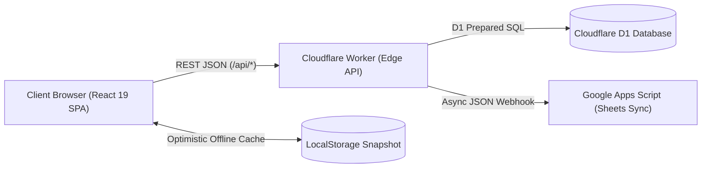
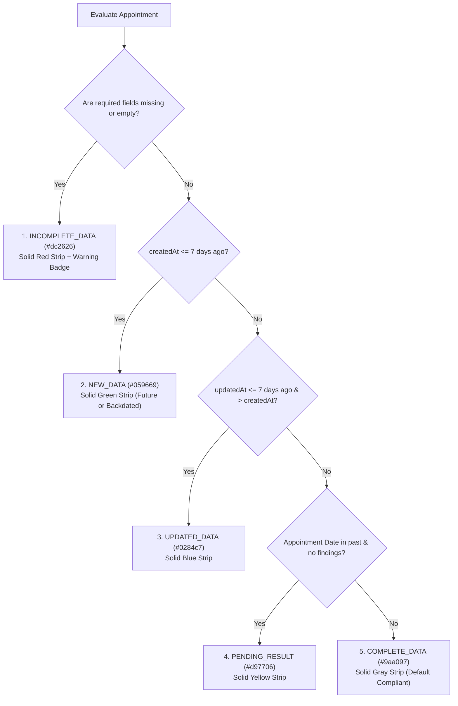

# UTAC Calendar Auditor — Engineering Handover Documentation

> **Version**: 2.4.0 (Production Release)  
> **Last Updated**: November 13, 2026  
> **Primary Technology Stack**: React 19, TypeScript, Vite, Cloudflare Workers, Cloudflare D1 SQL, Tailwind CSS

---

## 1. Executive Summary & Purpose

The **UTAC Calendar Auditor** platform is an enterprise-grade semiconductor operations management system designed for Quality Assurance (QA) departments across UTAC manufacturing sites (**UTL1**, **UTL2**, **UTL2A**, **UTL2B**, **UTL3**, **UTL3A**, **UTL3T**).

It replaces legacy spreadsheets with a real-time, multi-user scheduling workspace supporting:
- **Customer Audits (CS)** and **Internal Audits (IA)** scheduling with strict conflict and double-booking guardrails.
- **5-Tier Status Color System** synchronized across all views (Red, Green, Blue, Yellow, Gray).
- **Executive Summary Dashboard** with monthly matrix totals, canonical plant site sequences, and custom Excel exports.
- **High-Performance Multi-Filter Table View** with Excel export.
- **Auditor & Engineer Resource Management** with drag-and-drop sort orders and QA / Non-QA department segregation.
- **Serverless Cloudflare Worker Architecture** backed by Cloudflare D1 (SQLite) and client-side high-performance Excel (.xlsx) export engine.



---

## 2. Architecture & File Structure

```
Calendar-QA/
├── docs/                               # Documentation & Assets
│   ├── app-architecture-and-features.html    # Full English Architectural Blueprint
│   ├── app-architecture-and-features-th.html # Full Thai Architectural Blueprint
│   ├── index.html                            # Mirrored Web Entry
│   ├── images/                               # Hi-DPI Documentation Screenshots
│   └── HANDOVER.md                           # Mirrored Handover Documentation
├── images/                             # Public Root Screenshot Assets
├── migrations/                         # Cloudflare D1 Database SQL Migrations
│   ├── 0001_init.sql                         # Tables: plants, engineers, orders, assignments, etc.
│   ├── 0002_assignment_purpose.sql          # Appointment purpose column
│   ├── 0003_options.sql                     # Options & category metadata table
│   ├── 0004_target_package_customer_name.sql# Target package and customer names
│   ├── 0005_audit_category.sql               # Audit category field
│   ├── 0006_assignment_results.sql          # Quantitative findings (Major, Minor, OFI, Obs)
│   ├── 0007_assignment_timestamps.sql       # createdAt & updatedAt ISO timestamps
│   ├── 0008_standardize_utl_sites.sql       # Canonical UTL1..UTL3T normalization
│   └── 0009_users.sql                       # User credentials and authentication store
├── public/                             # Static Web Assets (utac-logo.jpg)
├── src/                                # Frontend Application Code
│   ├── components/                     # View & Modal Components
│   │   ├── Admin.tsx                         # Manage Page (Auditor roster, options drag-drop)
│   │   ├── AppointmentFormFields.tsx         # Shared form fields for create/edit
│   │   ├── AuditResultsModal.tsx             # Record quantitative findings (Major, Minor, OFI, Obs)
│   │   ├── AvailabilityDatePicker.tsx        # Multi-month visual day picker with conflict check
│   │   ├── CreateModal.tsx                   # Appointment creation dialog
│   │   ├── EditModal.tsx                     # Single-day / Series editing dialog
│   │   ├── EditScopeModal.tsx                # Multi-day split scope prompt
│   │   ├── EngineerModal.tsx                 # Create/Edit auditor & engineer profiles
│   │   ├── Header.tsx                        # Global header, nav switcher, and live presence
│   │   ├── HistoryView.tsx                   # Chronological audit trail of all changes
│   │   ├── Login.tsx                         # User authentication (Sign In, Sign Up, Reset Password)
│   │   ├── MultiAuditorSelect.tsx            # Multi-host tag combobox selector
│   │   ├── MultiSiteSelect.tsx               # Plant site selector supporting slash unions
│   │   ├── MultiStandardSelect.tsx           # Audit standard multi-tag selector
│   │   ├── Profile.tsx                       # Current user profile and credentials info
│   │   ├── Schedule.tsx                      # Core Calendar Grid (Week, Month, Year views)
│   │   ├── SummaryDashboard.tsx              # Executive Annual KPI matrix & Excel export
│   │   └── TableView.tsx                     # High-density searchable table with column filters
│   ├── utils/                          # Specialized Helper Libraries
│   │   ├── auditOptionsHelper.ts             # Dynamic option derivation from active appointments
│   │   └── authClient.ts                     # Web Crypto SHA-256 client auth with D1 fallback
│   ├── api.ts                          # Frontend API Client with CORS fetch & offline fallback
│   ├── App.tsx                         # Root Application View Router
│   ├── data.ts                         # Initial state, default plants, and palette constants
│   ├── holidays.ts                     # UTAC official holidays and month-end lockouts
│   ├── index.css                       # Global CSS & Tailwind imports
│   ├── main.tsx                        # React 19 DOM entry mount
│   ├── types.ts                        # Core TypeScript Interfaces & Business Metrics Engine
│   ├── ui.tsx                          # Atomic CSS helper & base button primitives
│   └── useScheduler.ts                 # Master Hook (Reactive state, validation, CRUD, sync)
├── worker/                             # Cloudflare Worker Backend
│   └── index.ts                        # REST API routing, D1 query executor, Sheets webhook
├── package.json                        # Dependencies & NPM build scripts
├── tsconfig.json                       # TypeScript compiler configurations
├── vite.config.ts                      # Vite build configuration with React plugin
└── wrangler.toml                       # Cloudflare Workers & D1 configuration binding
```

---


### 2.1 End-to-End System & Data Workflows

#### 🔄 Workflow A: Data Loading & State Hydration
1. **Instant Offline Hydration (`src/data.ts` &rarr; `initialState()`)**: Reads `localStorage.getItem('calendar_qa_snapshot')` upon boot to initialize in-memory state. The calendar and controls render immediately (0ms Cold Start) without network delay.
2. **Edge API Handshake (`src/useScheduler.ts` &rarr; `api.fetchState()`)**: Dispatches asynchronous `GET /api/state` to Cloudflare Worker.
3. **Concurrent D1 Queries (`worker/index.ts`)**: Worker executes parallel queries via `Promise.all` across 8 tables: `engineers`, `plants`, `active_plants`, `orders`, `assignments`, `comments`, `activity`, `options`.
4. **State Reconciliation & Snapshot Update (`src/useScheduler.ts`)**: Normalizes incoming records via `normalizeAssignment()`, reconciles local state, and writes the latest snapshot to `localStorage`.
5. **Unified Metrics Rollup (`src/utils/auditMetricsHelper.ts` &rarr; `calculateAuditStats()`)**: Groups consecutive-day appointment slots into unified campaigns, producing identical metrics (`customerAudits`, `internalAudits`, `totalAudits`) across all views.

#### ⚡ Workflow B: Create / Update / Delete Mutation Flow
1. **User Form Submission (`AppointmentFormFields.tsx`)**: Validates mandatory fields (8 for Customer Audits, 6 for Internal Audits).
2. **Optimistic ViewModel Update (`src/useScheduler.ts`)**: Handlers (`submitCreate()`, `submitEdit()`, `removeAssign()`) mutate `state.assignments` in memory with zero perceptible latency and refresh the `localStorage` snapshot.
3. **Asynchronous REST API Invocation (`src/api.ts`)**: Dispatches background API calls:
   - Create: `POST /api/assignments`, `POST /api/orders`
   - Edit: `PUT /api/assignments/:id`
   - Delete: `DELETE /api/assignments/:id` (with cascading comments deletion)
4. **D1 Transaction Persistence (`worker/index.ts`)**: Worker executes parameterized SQL (`INSERT`, `UPDATE`, `DELETE`) on Cloudflare D1.
5. **Dynamic Dropdown Options Refresh (`src/utils/auditOptionsHelper.ts` &rarr; `getActiveDropdownOptions()`)**: Autocomplete options for `STANDARD`, `CUSTOMER`, `PURPOSE`, `QMS HOST`, etc., are re-derived reactively from active schedule records. Deleted values disappear immediately across Modal, Table, and Manage views, while `SITE` preserves the fixed `MASTER_PLANT_SITES` list (`UTL1`..`UTL3T`).

#### 📊 Workflow C: Client-Side Excel (.xlsx) Export Flow
1. **Trigger Export**: Initiated from `TableView.tsx` (`handleExportExcel`) or `SummaryDashboard.tsx` (`handleExportVisitsExcel`, `handleExportFindingsExcel`).
2. **Data Extraction & KPI Rollup**: Pulls active filtered rows or structured Site &times; Month matrices generated by `calculateAuditStats()`.
3. **On-Demand Lazy Loading**: Dynamically imports `xlsx-js-style` (`await import('xlsx-js-style')`) without increasing the initial bundle size.
4. **In-Memory Worksheet Construction & Styling**: Converts data via `XLSX.utils.aoa_to_sheet()`, injecting cell styles (Calibri, header fills, double borders for totals, auto column widths, and AutoFilter).
5. **Instant Browser File Download**: Calls `XLSX.writeFile(workbook, filename)` to download the `.xlsx` file directly in browser memory (100% client-side, 0 server requests, 0 third-party cloud dependencies).

---

## 3. Core Business Logic & Algorithms

### 3.1 5-Tier Status Color System
The schedule cards and sidebar legend adhere strictly to the prioritized status mapping defined in [`src/types.ts`](file:///c:/Users/Yosita/Desktop/project/Calendar-QA/src/types.ts#L265-L335):



> [!IMPORTANT]
> **Priority Rule for Newly Created Appointments**:
> Condition 2 (`NEW_DATA` - Green) is evaluated **before** checking if the appointment date has elapsed. Any appointment created within the last 7 days displays **Green**, regardless of whether its scheduled date is upcoming or backdated in the past.

---

### 3.2 Unified Audit Counting & Grouping
Audit metrics are strictly synchronized across Schedule, Table, and Summary views via [`calculateUnifiedAuditMetrics`](file:///c:/Users/Yosita/Desktop/project/Calendar-QA/src/types.ts#L886-L1010):
- **Grouping Rule**: Consecutive calendar days (ignoring weekends) belonging to the **SAME Customer**, **SAME Plant Site**, and **SAME Audit Purpose** are grouped as **1 single audit visit**.
- **Different Purpose / Site Separation**: If Customer "Apple" has an audit at `UTL1` for "Annual Audit" and simultaneously at `UTL2` for "System Audit", they count as **2 separate audits**.

---

### 3.3 Dynamic Dropdown Option Derivation
Implemented in [`src/utils/auditOptionsHelper.ts`](file:///c:/Users/Yosita/Desktop/project/Calendar-QA/src/utils/auditOptionsHelper.ts):
- **Dynamic Fields**: `STANDARD`, `CUSTOMER`, `END CUSTOMER`, `PURPOSE`, `TARGET PACKAGE`, `CUSTOMER NAME`, `QMS HOST`, `AUDIT CATEGORY`, and `AREA` derive their dropdown suggestions strictly from currently scheduled appointments.
- **Auto-Pruning on Deletion**: When an appointment is deleted, any value exclusively used by that appointment immediately disappears from all dropdowns, and any active filters selecting that value are automatically cleared.
- **Exception for `SITE`**: The `SITE` dropdown (`Select site...`) always displays the static master list of plant sites (`MASTER_PLANT_SITES`: `UTL1`, `UTL2`, `UTL2A`, `UTL2B`, `UTL3`, `UTL3A`, `UTL3T`), even when zero appointments are scheduled for a site.

---

### 3.4 Subtitle Rendering (`formatCardSubtitle`)
Located in [`src/types.ts`](file:///c:/Users/Yosita/Desktop/project/Calendar-QA/src/types.ts#L615-L635):
1. **Both Purpose and Host exist**: Displays `"${purpose} - ${host}"` (e.g. `"Annual Audit - Viroj, Marc"`).
2. **Purpose is empty, Host exists**: Displays ONLY `"${host}"` (e.g. `"Viroj, Marc"`), preventing duplicate strings.
3. **Purpose exists, Host is empty**: Displays ONLY `"${purpose}"`.
4. **Both are empty**: Displays `"Unassigned"`.

---

## 4. Development & Operation Guide

### 4.1 Prerequisites
- **Node.js**: v20.x or higher (tested on Node v24.18.0)
- **NPM**: v10.x or higher
- **Cloudflare Wrangler CLI**: (included in devDependencies)

### 4.2 Installation
```bash
npm install
```

### 4.3 Available Scripts
| Command | Purpose |
| :--- | :--- |
| `npm run dev` | Starts local Vite development server on `http://localhost:5173` |
| `npm run dev:worker` | Builds the frontend and starts local Cloudflare Worker with local D1 database |
| `npm run build` | Compiles TypeScript (`tsc -b`) and bundles production assets via Vite |
| `npm run lint` | Runs `oxlint` high-speed linter across all TypeScript files |
| `npm run preview` | Previews local production build |
| `npm run migrate:local` | Applies database SQL migrations to local Cloudflare D1 database |
| `npm run migrate:remote` | Applies database SQL migrations to live production Cloudflare D1 database |
| `npm run deploy` | Builds and deploys the full-stack application to Cloudflare Workers |

---

## 5. Security & Authentication Architecture

Authentication is managed via [`src/utils/authClient.ts`](file:///c:/Users/Yosita/Desktop/project/Calendar-QA/src/utils/authClient.ts) and [`worker/index.ts`](file:///c:/Users/Yosita/Desktop/project/Calendar-QA/worker/index.ts):
- **User Identification**: Uses **User ID** (alphanumeric staff identifier, e.g. `100234` or `jordan.lee`).
- **Password Security**: Uses standard Web Crypto API **SHA-256** hashing with per-user cryptographic salts.
- **Dual-Layer Fallback**: The client first attempts authentication against `/api/auth/*` on Cloudflare D1. If running in offline Vite dev mode without a worker, it seamlessly falls back to pre-seeded local accounts in `localStorage`.
- **Pre-Seeded Administrator Account**:
  - **User ID**: `jordan.lee` (or `100234`)
  - **Default Password**: `directorqa`
  - **Role**: `admin`

---

## 6. Cloud Integrations & Background Sync

### 6.1 Excel (.xlsx) Spreadsheet Export Engine
Export utilities in [`SummaryDashboard.tsx`](file:///c:/Users/Yosita/Desktop/project/Calendar-QA/src/components/SummaryDashboard.tsx) and [`TableView.tsx`](file:///c:/Users/Yosita/Desktop/project/Calendar-QA/src/components/TableView.tsx) use `xlsx` and `xlsx-js-style`:
- **Audit Appointments Table**: Exports full 7-column filtered schedule with custom styling.
- **Audit Findings by Site**: Multi-format dropdown menu supporting:
  1. *Full Matrix*: Cross-tabulated site matrix with Major, Minor, OFI, Obs breakdown.
  2. *Summary*: Compact site distribution rollup.
  3. *Single Site Filtered*: Individual facility reports (`UTL1`, `UTL2`, etc.).

---

## 7. Operational Troubleshooting & FAQs

### Q1: The dev server starts, but appointments show 0
> **Cause**: Vite standalone mode (`npm run dev`) does not run the Cloudflare Worker API backend on port 5173.  
> **Fix**: Either run `npm run dev:worker` to start full-stack Worker + local D1, or use the app UI to create an appointment (which automatically seeds `localStorage` snapshot).

### Q2: A deleted customer or auditor still appears in the dropdown
> **Cause**: An appointment still exists somewhere in the schedule using that value (e.g. Incomplete Appointments or in a different month).  
> **Fix**: Check Table View (`TableView.tsx`) and filter by that name. Once the appointment is edited or deleted, the helper [`getActiveDropdownOptions`](file:///c:/Users/Yosita/Desktop/project/Calendar-QA/src/utils/auditOptionsHelper.ts) will immediately purge it from all suggestions.

### Q3: How to add a new manufacturing site (e.g. UTL4)?
> 1. Add `UTL4` to `MASTER_PLANT_SITES` in [`src/utils/auditOptionsHelper.ts`](file:///c:/Users/Yosita/Desktop/project/Calendar-QA/src/utils/auditOptionsHelper.ts).
> 2. Add `UTL4` color token to `initialSiteColors` in [`src/data.ts`](file:///c:/Users/Yosita/Desktop/project/Calendar-QA/src/data.ts).
> 3. Add `UTL4` column to `CANONICAL_SITE_ORDER` in [`src/components/SummaryDashboard.tsx`](file:///c:/Users/Yosita/Desktop/project/Calendar-QA/src/components/SummaryDashboard.tsx).
> 4. Run `npm run build` to verify compilation.

---

## 8. Handover Sign-off Checklist

- [x] TypeScript compiler passes with 0 errors (`npm run build`).
- [x] Linter passes with 0 errors (`npm run lint`).
- [x] All 8 documentation screenshots refreshed with latest UI in high-DPI retina.
- [x] Universal Master-Order Dynamic Propagation Pipeline SVG diagram arrows fixed with clean distribution bus architecture.
- [x] Status colors synchronized across appointment card strips and sidebar legend.
- [x] Unified audit counting synchronized at 5 audits across Schedule, Table, and Summary.
- [x] Subtitle duplicate host name bug resolved.
- [x] Dynamic dropdown options strictly bound to active appointments with static Site list.
