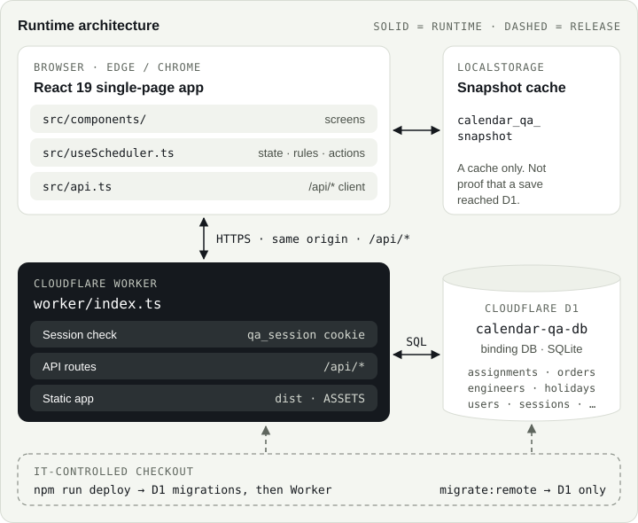

# Developer Guide

How UTAC QA Calendar (QMS-CASS) is built, how to run it locally, and how to change it without breaking the link between screens, rules, API, and database. Production operation (ownership, releases, recovery, security review) is in the [IT Handover](it-handover.md).

> [!CAUTION]
> `npm run deploy` and `npm run migrate:remote` change the live Worker and database. Work against local D1, and run production commands only with IT and QA data-owner approval.

## 1. Architecture

A React 19 and TypeScript single-page app, built by Vite. One Cloudflare Worker serves the built files and the `/api/*` API. Shared data lives in Cloudflare D1 (SQLite).



| Part | Where | Job |
|---|---|---|
| Screens | `src/components/` | Render views and call callbacks from the view model |
| State hub | `src/useScheduler.ts` | State, navigation, filters, validation, create/edit/delete, and the view model (`VM`) |
| Domain rules | `src/types.ts`, `src/holidays.ts`, `src/utils/` | Types, normalization, required fields, status, day rules, metrics, dropdown options |
| API client | `src/api.ts`, `src/utils/authClient.ts` | Same-origin calls to `/api/*`; sign-in and session |
| Worker | `worker/index.ts` | Session checks, API routing, D1 SQL, static asset fallback |
| Schema | `migrations/*.sql`, plus `ensure*()` in `worker/index.ts` | Ordered D1 migrations; the Worker also makes some schema changes at runtime (see 4.1) |
| Config | `wrangler.toml` | Worker name, `dist` asset binding, D1 binding |

## 2. Run locally

### 2.1 Install

Use **Node.js 22.12 or later** (Wrangler needs 22+, Vite and oxlint need 22.12+), then from the repository root:

```bash
npm ci
```

### 2.2 Frontend only

```bash
npm run dev
```

Vite on `http://localhost:5173`, good for layout and component work. There is no Worker, D1 or `/api` proxy:

- Sign-in falls back to accounts stored in the browser (development builds only). Create one through **Sign up**.
- Data comes from the `calendar_qa_snapshot` in `localStorage` (the same cache production uses), so the calendar starts empty.
- Expect the "Could not load the shared calendar" banner on load and a save-failure banner on every change, because `/api/*` is not served.

### 2.3 Worker with local D1

1. Apply migrations to the local database **before** starting the Worker (see 9, step 3):

   ```bash
   npm run migrate:local
   ```

2. To test sign-up, create an untracked `.dev.vars` file in the repository root:

   ```dotenv
   REGISTRATION_CODE=any-local-test-value
   ```

3. Build and start the Worker:

   ```bash
   npm run dev:worker
   ```

   Wrangler prints the local URL.

> [!WARNING]
> Never put a production registration code, Cloudflare token, or real customer data in `.dev.vars`, source, logs, or committed screenshots. Never point local development at the production D1 database.

### 2.4 Scripts

| Command | What it does |
|---|---|
| `npm run dev` | Vite dev server, frontend only |
| `npm run dev:worker` | Build, then `wrangler dev` with local D1 |
| `npm run build` | Type-check (`tsc -b`) and bundle with Vite |
| `npm run lint` | `oxlint` |
| `npm test` | Regression tests: Customer vs Internal Audit classification, and when an audit counts as having a result |
| `npm run preview` | Preview the production build |
| `npm run migrate:local` | Apply migrations to local D1 |
| `npm run migrate:remote` | Apply migrations to the D1 database in `wrangler.toml` (production) |
| `npm run deploy` | Release (`scripts/deploy.mjs`): build, list pending D1 migrations and ask to confirm, print a Time Travel restore point, apply them, then `wrangler deploy`. Declining or a failed migration stops it before the code deploys. `-- --local` rehearses against local D1 without deploying. |
| `npm run docs` | Rebuild the HTML documentation (and its search index) from these Markdown files |
| `npm run docs:screenshots` | Recapture the doc screenshots from the running dev app |

## 3. How the app starts

1. `src/main.tsx` mounts `<App />`; `src/App.tsx` calls `useScheduler()` and shows Login or the app.
2. `initialState()` in `src/data.ts` loads defaults, the browser snapshot (`calendar_qa_snapshot`), saved notes (`calendar_qa_comments`) and the remembered user (`calendar_qa_session_user`). A remembered user makes the app open signed in. The month and year come from `getCurrentCalendarDefaults(new Date())`.
3. `useScheduler()` checks the server session with `authClient.getSession()` (`GET /api/auth/session`, the HttpOnly cookie checked against D1). If the session has ended (401), the app **keeps** the remembered identity and the cached snapshot and does not load server data; every save then fails until the user signs out and in again.
4. With a valid session it calls `api.fetchState()` (`GET /api/state`) once. The Worker reads engineers, plants, active plants, orders, assignments, comments, the latest 50 `activity` rows, options, holidays, and the latest 200 History entries in parallel. There is no polling: other users' changes appear after a reload.
5. The client normalizes the records (`normalizeAssignment`, `normalizeSite`, …) and refreshes the snapshot. From here D1 is the source of truth; the snapshot is only a cache. History shows the server's entries plus any entry this browser could not save (marked "This browser only"); only those unsaved entries are cached.

If the screen is empty, check which mode you are in (Vite only or Worker + D1), whether you are signed in, and what `/api/auth/session` and `/api/state` return in DevTools.

## 4. Data model

### 4.1 D1 tables

| Table | Key | Holds |
|---|---|---|
| `assignments` | `id` | One row per bookable appointment day: `audit_type` (`customer`, `internal`, or `''` = unknown, treated as CS), site, customer, purpose, audit fields, results (per site; `recorded: true` marks a saved result, so all-zero counts still count as a result), timestamps. Foreign keys to `engineers.id` (`eng`) and `orders.id` (`order_id`). |
| `orders` | `id` | One row per appointment. Every day of the appointment shares it, so it is what links a series. `product` holds the end customer (CS) or area (IA); `plant` holds the site (CS) or standard (IA). |
| `engineers` | `id` | QMS Hosts: name, role, department, sub-departments, plus `site` and `host_department`. A row is created automatically when a new host name is typed in the form. |
| `comments` | `id` | Day notes; `assignment_id` links to `assignments`. Author and time are not recorded (always "You", "just now"). |
| `plants` / `active_plants` | `id` / `plant_id` | Legacy QMS / EHS / ESD plant records and their active flag. No screen uses them. |
| `options` | `(category, value)` | Dropdown values. Sites are `site_code` rows with their color in `meta`. Custom orders are stored as JSON in `_order_<category>` rows. |
| `custom_holidays` | `date` | Holiday, shutdown, no-customer-audit, and working-day rules, with locked sites |
| `activity` | `id` | The legacy activity feed (shown on Profile) and audit rows for holiday changes, attributed to the signed-in account. Not used by the History screen. |
| `history_log` | `id` | The shared History (migration `0021`): one row per change, with the user and time set by the Worker from the session; action, entity, description and metadata come from the browser. |
| `users` | `id` | Username, password hash and salt, display name, role |
| `sessions` | `token_hash` | Server sessions (logical link to `users`; no foreign key). Expired rows are not purged. |

Read the migrations in numeric order from `0001_init.sql`. Never edit a migration that may already be applied; add the next number.

The Worker also changes the schema at runtime: on the first request of each Worker instance, `ensureAssignmentColumns()`, `ensureUsersTable()`, `ensureSessionsTable()` and `ensureCustomHolidaysTable()` add columns and tables if missing. `assignments.department`, `engineers.site` and `engineers.host_department` exist **only** through these functions. `ensureSessionsTable()` also deletes the old demo users and promotes the oldest account to admin when there is none, on every cold start.

### 4.2 Multi-day appointments

An appointment that spans several days is several `assignments` rows, one per bookable weekday (weekends and public holidays are skipped when the rows are created). The rows are linked by their shared `order_id` (and `eng`). The client also sets `seriesId` / `groupId`, but they are **not** stored, so after a reload the series is found by `order` + `eng`. Every edit or delete must handle "this day only" versus "the whole series". Audit results are stored per site in `results` and normalized by `normalizeAuditResults()`; they are shared across the series.

## 5. API

All routes are same-origin under `/api/`. The Worker answers a cross-origin request (Origin or `Sec-Fetch-Site` check) with 403 "Cross-origin request denied." Every route needs a valid session except `auth/session` (returns its own 401), `auth/logout`, `auth/login`, `auth/register` and `auth/reset-password`. The aliases `auth/signin`, `auth/signup` and `auth/reset` behave the same.

| Route | Methods | Purpose |
|---|---|---|
| `auth/session` | `GET` | Current session |
| `auth/login` | `POST` | Sign in |
| `auth/register` | `POST` | Sign up; needs `REGISTRATION_CODE` (returns 403 if it is not set) |
| `auth/reset-password` | `POST` | Change password with the **current** password (there is no forgotten-password reset); revokes the account's sessions |
| `auth/logout` | `POST` | Revoke the current session |
| `state` | `GET` | Everything the app needs at startup |
| `assignments` · `assignments/:id` | `GET` `POST` · `PUT` `DELETE` | Appointment days. `PUT` merges a partial body onto the stored row. |
| `orders` · `orders/:id` | `GET` `POST` · `PUT` `DELETE` | Orders. `DELETE` also deletes every linked assignment and its comments. |
| `engineers` · `engineers/:id` | `GET` `POST` · `PUT` `DELETE` | QMS Hosts. `DELETE` also deletes every linked assignment and its comments. |
| `plants` · `plants/:id` · `plants/:id/toggle` | `GET` `POST` · `DELETE` · `POST` | Legacy plants (unused by the UI) |
| `comments` · `comments/:id` | `POST` · `DELETE` | Day notes |
| `history` | `GET` `POST` | Shared History. `GET` pages newest first (`before`, `beforeId`, `limit` up to 500; default 200). `POST` stores one entry; the Worker sets the user and time and checks the action and entity names. |
| `activity` | `POST` | Legacy activity feed |
| `options` · `options/reorder` | `POST` `DELETE` · `PUT` | Dropdown values and their order |
| `holidays` · `holidays/:date` · `holidays/reset` | `GET` `POST` `DELETE` · `DELETE` · `POST` | Day rules, bulk delete, reset a year; each change writes an `activity` row |

Sessions use the HttpOnly `qa_session` cookie (`SameSite=Lax`, `Secure` only over HTTPS). With **Remember me** the cookie lasts 30 days; without it the cookie has no expiry, so it ends when the browser closes, and the server expires it after 12 hours. The constants are at the top of `worker/index.ts`. A 500 response returns the raw exception text, and the Worker does not log it.

## 6. Business rules

Each rule has one home in code. Change it there, not in a component.

| Rule | Where |
|---|---|
| Seven sites `UTL1` `UTL2` `UTL2A` `UTL2B` `UTL3` `UTL3A` `UTL3T`; legacy values normalized | `normalizeSite()` / `normalizeSites()` in `src/types.ts`; `MASTER_PLANT_SITES` in `src/utils/auditOptionsHelper.ts` |
| Customer vs Internal Audit: stored in `audit_type` (migration `0020`). Without it, decided from content: customer fields → CS, area / audit category → IA. Never from `site2`, `auditor2`, `department2`: those are compatibility copies on every row. An id, order, code or title starting with "IA" also means IA. | `isInternalAssignment()` in `src/types.ts`; covered by `npm test` |
| CS needs 8 fields, IA needs 5, both need a valid date range | `getMissingFields()` and `isAppointmentFormIncomplete()` in `src/types.ts` |
| Status: Incomplete → Updated → New → Pending Result → Complete, 7-day windows. An audit has a result when a site result is saved (`recorded: true`, set by **Save Results**) or any count is above 0; **Clear Results** saves zeros without the flag. | `resolveAuditStatus()`, `isAuditResultCompleted()` and `STATUS_COLOR_MAP` in `src/types.ts` |
| Card fill and border from status (`getApptCardColors()`); left strip from the site color (`siteColorsOfAssignment()` + `getAccentStyle()`) | `src/useScheduler.ts`; site colors are `initialSiteColors` (`src/data.ts`) overlaid with D1 `site_code` options, edited in Manage → Options → Site |
| Public Holiday and weekends are skipped from a range; No Customer Audits blocks CS; Shutdown Plant blocks CS at all sites and IA only at locked sites; Working Day overrides a built-in holiday | `src/holidays.ts`; enforced **only in the browser**, in `submitCreate()` / `submitEdit()`. Drag-move, duplicate, copy-week and the Worker do not check them. |
| Dropdown suggestions come from appointments in use, except Site (fixed list) | `getActiveDropdownOptions()` in `src/utils/auditOptionsHelper.ts` |
| Days with the same type, entity, site and purpose count as one audit when they are at most 1 calendar day apart (so Friday → Monday counts twice, and a holiday splits a run). For IA the entity is standard / category / area and the purpose is the area. | `calculateAuditStats()` in `src/utils/auditMetricsHelper.ts` (`calculateUnifiedAuditMetrics` is an alias) |
| Card subtitle: "purpose - host"; cards show "purpose - Unassigned" when there is no host, "Unassigned" when there is neither | `formatCardSubtitle()` in `src/types.ts` |
| Multi-value separators: Site `/`; Standard, QMS Host, Purpose, Target Package, Customer Name `, `; Area ` / `. The Worker joins a `qmsHost` array with `, ` and a `standard` array with `/`. | Form fields in `AppointmentFormFields.tsx`; normalizers in `src/types.ts` |

## 7. Making changes

### 7.1 Change a screen

1. Find the component that renders it from `src/App.tsx`.
2. Trace its props back to the `VM` returned by `useScheduler()`.
3. Put markup and interaction in the component, state and actions in the hook, shared rules in the domain helpers.
4. Check wide and narrow layouts, loading, empty, and error states, and keyboard focus. Below 860px (`vm.isMobile`) the app uses its phone layout: `BottomNav` instead of the header tabs, cards instead of tables in Table and History, a period bar with Today and arrows in the Schedule toolbar (`PhonePeriodBar`, `goToday`), and in Month view a dot grid with the chosen day's list underneath (`MonthMobile`, `monthAgenda`). On touch screens, give controls the `tap`, `tap-square` or `tap-hit` class from `src/index.css` so they are at least 44px.

### 7.2 Add a field to appointments

Change the whole path, top to bottom:

1. Types and meaning: `Assignment`, `CreateDraft`, `EditDraft` in `src/types.ts`, and `normalizeAssignment()`.
2. Defaults and hydration: `src/data.ts`, `src/useScheduler.ts`.
3. Form control: `AppointmentFormFields.tsx`, for CS and IA, in create and edit; the object builders in `submitCreate()` / `submitEdit()` and the draft filled by `openEdit()`.
4. Validation: `getMissingFields()` if the field is required; decide whether it affects the red status.
5. API: `src/api.ts`; in the Worker, `assignmentOut()` and the explicit `INSERT` / `UPDATE` column lists for `assignments`.
6. A new migration, `migrations/0021_<name>.sql` (use the next free number), tested on local D1 with existing data. Do **not** also add the column in `ensureAssignmentColumns()` (see 9).
7. Cards and details, filters, Table, Summary and exports, History, as relevant.
8. The user and developer guides.

Do not add a form field without its API and database path. Do not break old rows where the field is empty.

### 7.3 Add an API route

1. Define request and response types and add the client method in `src/api.ts`.
2. Add the route in `handleApi()` in `worker/index.ts`; check method, payload, and errors.
3. Bind every request value with `DB.prepare(...).bind(...)`. Never build SQL from strings.
4. Remember that `admin` is not enforced server-side yet (see the [IT Handover](it-handover.md#4-security-findings)), and that the Worker does not validate required fields. Add explicit checks if the route needs them.

### 7.4 Change status colors or rules

Edit `resolveAuditStatus()` and `STATUS_COLOR_MAP` in `src/types.ts`, and `getApptCardColors()` for fills. Keep the site strip as the site color, never the status color. Check the sidebar legend, Schedule, Table, compact cards, and these guides.

### 7.5 Change holiday rules

Touch every layer:

- the Manage UI (`HolidaysPanel.tsx`) and `src/holidays.ts`, including the built-in tables `FIXED_ANNUAL_HOLIDAYS` and `LUNAR_BUDDHIST_HOLIDAYS` (lunar dates are defined only for 2026–2028)
- validation in `submitCreate()` / `submitEdit()`, and the places that stop holiday cells being clicked in `src/useScheduler.ts`
- the `custom_holidays` routes and their type whitelist in the Worker, and `CustomHolidayType` (`src/holidays.ts`, `src/api.ts`)

Changing a cell's color alone does not change what can be booked.

### 7.6 Change an export

Exports live in `TableView.tsx` (`handleExportExcel`, `handleExportCSV`) and `SummaryDashboard.tsx` (`handleExportVisitsExcel`, `handleExportFindingsExcel`). The Excel files are built in the browser with `xlsx-js-style`, loaded on demand; the `xlsx` package in `package.json` is not imported. Check that the export follows the current filters, year, sites, and column order, then open the file.

### 7.7 Add a site

Site codes are hard-coded in several places. Update all of them, then run `npm run build`:

1. `MASTER_PLANT_SITES` (`src/utils/auditOptionsHelper.ts`), `SITE_ORDER` (`src/types.ts`), `initialSiteCodeOptions` and `initialSiteColors` (`src/data.ts`), `SHUTDOWN_SITE_OPTIONS` (`src/holidays.ts`).
2. The `normalizeSite` patterns in `src/types.ts` and `worker/index.ts`, and `cleanSite` in `src/utils/auditMetricsHelper.ts`. They only match the current codes.
3. In `SummaryDashboard.tsx`: `CANONICAL_SITE_ORDER`, `DEFAULT_SITE_PALETTE`, `normalizeToTargetSite`, the `expandedSites` defaults, and the "7 Sites (…)" text.
4. The Worker's `SITE_ORDER` (it also drives the "All Sites" labels), and the IA site filter in `AppointmentFormFields.tsx`.
5. A D1 `options` row with category `site_code` and its color in `meta`, added in Manage → Options → Site or by a migration. The site list in the app comes from D1.
6. Optional: `SITE_COLORS` in `scripts/build-docs.mjs`, for the docs.

## 8. Check your work

Before review:

```bash
npm test          # audit type and audit result regression tests
npm run lint
npm run build
```

Then test by hand on Worker + local D1, for what you touched:

- sign-in, refresh, sign-out (if auth changed);
- create, edit, delete for both CS and IA, including multi-day and one-day-of-series;
- required fields, red drafts, and holiday rules;
- QMS Hosts, filters, Schedule and Table agreeing, Summary, History, exports;
- no errors in DevTools; data still there after reload.

In the pull request, list the changed files, affected rules, any migration, how you tested, and risks. Never attach secrets or real customer data.

## 9. Migrations and release

1. Number the migration after the latest committed one and name it clearly.
2. Write it to work with existing rows; note whether it can be undone.
   It must also work with the Worker that is **currently live**: `npm run deploy` applies migrations a moment before the new code goes out. Adding tables or columns is fine. Removing or renaming a column the live code still reads must wait for a later release, after the code that stopped using it is deployed.
3. Never create the same column in both a migration and an `ensure*()` function. If a Worker that adds the column runs first, the migration then fails with "duplicate column name" and the release stops. Dropping a column that `ensureAssignmentColumns()` adds is undone at the next cold start. For the same reason, run `npm run migrate:local` before `npm run dev:worker`.
4. Apply locally with `npm run migrate:local`, or rehearse the release with `npm run deploy -- --local`, and check reads and writes before and after.
5. Get code review and QA data-owner approval.
6. IT releases with `npm run deploy`, which applies pending migrations and then deploys the code. Follow the [release runbook](it-handover.md#5-release-and-database-runbook).

There is no staging environment in `wrangler.toml`. Local is not staging, and production D1 is never a test database.

## 10. Troubleshooting

| Symptom | Check |
|---|---|
| App opens but shows no or odd data | Vite only (`npm run dev`) or Worker (`npm run dev:worker`)? Vite does not serve `/api`, so it always shows the load and save banners. |
| API returns 401 | Session cookie, expiry, and that app and API share one origin |
| API returns 403 "Cross-origin request denied." | The request came from another origin, or a proxy changed `Origin` / `Sec-Fetch-Site` |
| Saved data gone after reload | The save warning, the Network response, Worker logs, local D1. The optimistic UI is not proof of a write. |
| Dropdown missing a value, or showing an old one | An appointment still uses (or no longer uses) it; see `getActiveDropdownOptions()`. A value can also be hidden by `removedOptions` in this browser's snapshot. |
| History entries marked "This browser only" | Recorded before migration `0021`, or `POST /api/history` failed (the app shows a warning). A frontend-only run (`npm run dev`) never stores History on a server. |
| Build fails | Read the first `npm run build` error; check types, `VM`, and API payloads agree |
| Migration fails with "duplicate column name" | The column was already created by an `ensure*()` function (9, step 3) |
| Migration fails otherwise | Local schema and migration history; add a new migration instead of editing one |
| API works but the page does not load | `npm run build`, the `dist/` folder, `[assets]` and `ASSETS` in `wrangler.toml` |

## 11. Security notes

Read the [security findings](it-handover.md#4-security-findings) before widening access. In short:

- `admin` / `user` is a label, not a server-side permission. Do not assume Manage routes are admin-only.
- The Worker trusts the browser for required fields and holiday rules, and ids are generated in the browser.
- `localStorage` keeps the calendar snapshot, notes, History entries not yet saved to the server, and the remembered user after sign-out; with an ended session the app still opens on that cached data.
- History records the real user and time, but the description is written by the browser.
- Sign-up uses one shared `REGISTRATION_CODE`; passwords are salted SHA-256 with a 4-character minimum, and there is no rate limiting.
- Never log credentials, cookies, session tokens, registration codes, or unneeded customer data.

## 12. Code map

| To understand or change | Start with |
|---|---|
| App shell and navigation | `src/App.tsx`, `src/components/Header.tsx` |
| Startup, sign-in, hydration | `src/data.ts`, `src/useScheduler.ts`, `src/utils/authClient.ts` |
| Create, edit, delete | `AppointmentFormFields.tsx`, `CreateModal.tsx`, `EditModal.tsx`, `EditScopeModal.tsx`, `src/useScheduler.ts`, `src/api.ts`, `worker/index.ts` |
| Audit results | `AuditResultsModal.tsx`, `normalizeAuditResults()` |
| Holiday rules | `src/holidays.ts`, `HolidaysPanel.tsx`, `src/useScheduler.ts`, `worker/index.ts` |
| Status and site colors | `src/types.ts`, `src/useScheduler.ts`, `Schedule.tsx`, `TableView.tsx` |
| Excel and CSV export | `TableView.tsx`, `SummaryDashboard.tsx` |
| Database schema | `migrations/`, and the `ensure*()` functions in `worker/index.ts` |
| Release | `scripts/deploy.mjs` |
| History | `HistoryView.tsx`, `logActivity()` and `loadOlderHistory()` in `src/useScheduler.ts`, the `history` routes in `worker/index.ts` |
| Production operation | [IT Handover](it-handover.md) |
