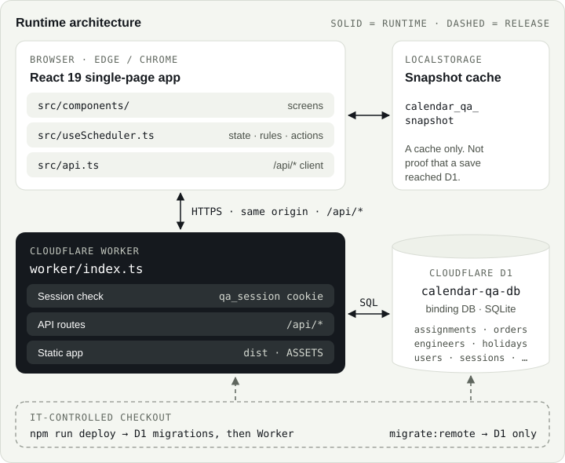

# IT Handover

Everything UTAC IT needs to take over UTAC QA Calendar (QMS-CASS): what to verify, who should own what, the open security findings and known issues, and how to release, migrate, recover, and respond to incidents. For how the code works, see the [Developer Guide](developer-guide.md).

> [!IMPORTANT]
> Reviewed against the repository on 27 November 2026. The live Cloudflare account, URL, deployed version, and database have **not** been verified from the repository. Confirm them before treating this as a production runbook.

## 1. System at a glance

- **What it is:** a shared web app for planning Customer Audits (CS) and Internal Audits (IA) across seven UTAC sites (`UTL1`, `UTL2`, `UTL2A`, `UTL2B`, `UTL3`, `UTL3A`, `UTL3T`), replacing spreadsheets. The app calls itself "Calendar Auditor".
- **Stack:** React 19, TypeScript, Vite; one Cloudflare Worker serving static assets and the `/api/*` API; Cloudflare D1 (SQLite).
- **Users:** QA Planners, QMS Hosts, QA Admins, and report users on Microsoft Edge or Google Chrome.
- **Data in D1:** audit schedules, customer names, QMS Host names, results, notes, holiday rules, the shared History (`history_log`), user accounts, and sessions.
- **Data in each browser (`localStorage`):** a copy of the schedule (`calendar_qa_snapshot`, which also holds option lists and any History entries that could not be saved to the server), notes (`calendar_qa_comments`), the remembered user (`calendar_qa_session_user`), and accounts created in that browser (`calendar_qa_users`).

## 2. Configuration to verify

These values come from the repository. Confirm each one in the company's Cloudflare and GitHub accounts.

| Item | Repository value | Notes |
|---|---|---|
| Worker name | `utac-qa-calendar` | `wrangler.toml` |
| Worker entry | `worker/index.ts` | Handles `/api/*` and serves the built app |
| Static assets | `dist`, binding `ASSETS` | Produced by `npm run build` |
| D1 binding | `DB` → `calendar-qa-db` | Database ID `11c524c4-b02e-4d38-840e-ee98294f2118` |
| Compatibility date | `2025-04-01` | |
| Secret | `REGISTRATION_CODE` | Gates sign-up; if it is not set, every sign-up is refused. Set with `npx wrangler secret put REGISTRATION_CODE`; never store its value in Git, tickets, or documents. |
| Session lifetime | 30 days with Remember me; otherwise until the browser closes, at most 12 hours | Constants in `worker/index.ts` |
| Logging | No `[observability]` block in `wrangler.toml` | Workers Logs may be off; check the dashboard |
| Source | GitHub remote `origin` | Ownership not confirmed |

**Pending schema changes:** migration `0020_assignment_audit_type.sql` adds and backfills `assignments.audit_type`, and `0021_history_log.sql` creates the `history_log` table for the shared History. The next `npm run deploy` applies both (see [5.2](#52-d1-schema-migration)). Both only add, so the live Worker keeps working while they run. Before that first release, check that the column does not already exist (an earlier test build added it at runtime): `npx wrangler d1 execute calendar-qa-db --remote --command "PRAGMA table_info(assignments)"`. If `audit_type` is listed, ask the maintainer how to mark 0020 as applied instead of running it.

**Not declared in the repository:** a staging environment, custom domain, Cloudflare account ID, CI/CD workflow, or monitoring alerts. That does not prove they do not exist; check the dashboards. A Git push alone does not deploy anything; deployment is `npm run deploy`.

## 3. Ownership and takeover

### 3.1 Proposed owners

Replace each role with a named person and escalation contact during the formal handover.

| Area | Proposed owner | Responsibilities |
|---|---|---|
| Cloudflare account and Worker | UTAC IT Cloud / Platform Operations | Account ownership, least-privilege access, Worker settings, deploy control, domain and routes, account recovery |
| D1 and data protection | IT Data / Platform Operations with the QA data owner | Migration approval, backup and restore policy, access, retention, recovery exercises, export decisions |
| QA process and data quality | QA / QMS process owner | Audit definitions, required fields, statuses, QMS Host roster, holiday rules, user acceptance |
| Source code and releases | Named IT application maintainer with a QA change approver | Repository access, code review, release process, change log, defect triage |
| Identity and security | UTAC IT Identity / Security | Registration policy, admin lifecycle, authentication review, incident response, any SSO / MFA / role-based access work |

### 3.2 Takeover checklist

1. Assign a Cloudflare account owner and at least two company-controlled administrators. Remove individual-only ownership and review user and token access.
2. Confirm the production Worker, URL or custom domain, D1 database, deployed version, Cloudflare account, and GitHub repository ownership. Record them in the company's service register, not in a public document.
3. Confirm whether `REGISTRATION_CODE` is set, who can rotate it, and whether self-registration should stay on.
4. Create IT-owned secrets and API access. Do not reuse a developer's personal Cloudflare credentials.
5. Review the [security findings](#4-security-findings) and [known issues](#7-known-application-issues) with IT Security and the QA data owner; assign an owner and decision to each.
6. Name the release approver, rollback decision-maker, support contact, data classification, retention, RPO / RTO, and escalation path.
7. Check D1 recovery coverage on the current Cloudflare plan and rehearse a recovery outside production.
8. Agree what proves a release succeeded: tests, lint and build, sign-in and sign-out, create / edit / delete, Excel download, D1 persistence seen from a second browser, and a clean Worker error log.

## 4. Security findings

Decide on each of these before broad production use.

| # | Finding | Risk | Suggested decision |
|---|---|---|---|
| 1 | `admin` / `user` is not an authorization boundary. The header shows a role, but every signed-in user can open Manage, and the Worker checks only for a valid session. | Any account can change master data and holiday rules. | Add and test server-side role checks, or accept the risk in writing. |
| 2 | Sign-up uses one shared `REGISTRATION_CODE`. The first account in an empty database becomes `admin`; later ones are `user`. The Worker promotes the oldest account to admin whenever none exists, on every cold start, so removing the last admin is undone. User IDs are case-insensitive. There is no screen to manage admins or disable leavers. | Anyone holding the code can create an account; leavers keep access. | Agree an account lifecycle and code-rotation process, or move to company SSO. |
| 3 | Passwords are hashed with salted SHA-256 and need only 4 characters. There is no rate limiting or lockout on sign-in or password change, error messages reveal whether an account exists, and the hash comparison is not constant-time. No SSO or MFA. | Password guessing; weak passwords; fast hash. | IT Security to approve, or require stronger hashing, rate limiting, a password policy, and SSO / MFA. |
| 4 | The browser keeps business data after sign-out: the schedule copy, option lists, notes, unsaved History entries and the remembered user (see section 1). When the server session has ended (for example the browser was closed without Remember me), the app still opens signed in and shows this cached data, without a valid session. If an account was created in that browser, changing its password also stores a salted hash of the new password in `calendar_qa_users`. | Data exposed on shared or lost devices. Medium on shared computers. | Apply managed-device policy; decide whether the app should clear or minimize `localStorage` on sign-out and when a session has ended. |
| 5 | History is stored in D1 (`history_log`) and shared, and the Worker records the signed-in account and the time. But the browser writes each entry: what is described comes from the app, a change is recorded only if the browser sends the entry, and any signed-in user can add entries through the API. QMS Host roster changes are not recorded. | History is reliable for who and when, but not proof of what changed. | Decide whether this is enough as the official audit trail; if not, have the Worker record changes itself in each write route. |
| 6 | The Worker trusts the browser: required fields and holiday rules are checked only in the browser, ids are generated by the browser (two people creating at once can collide, which fails a save or merges two appointments), and edits are last-write-wins. | Inconsistent or merged records. | Add server-side validation and server-generated ids. |
| 7 | A 500 response returns the raw exception text, and errors are not logged. | Internal details disclosed; failures invisible in logs. | Log errors server-side and return a generic message. |
| 8 | The `xlsx@0.18.5` dependency is unused and has published security advisories. | Supply-chain exposure for no benefit. | Remove it; run `npm audit` as part of releases. |

Other controls already in place: sessions are random tokens stored only as hashes in D1 and sent in an HttpOnly, `SameSite=Lax` cookie (`Secure` over HTTPS); changing a password revokes all of that account's sessions; the Worker rejects cross-origin requests; all SQL uses bound parameters.

## 5. Release and database runbook

The repository has one Wrangler configuration and no staging environment. Run production commands only from an IT-controlled checkout after confirming the target account and database.

### 5.1 Code release

1. Review the approved commit and confirm the branch and production target.
2. Install exact dependencies: `npm ci`.
3. Run `npm test`, `npm run lint` and `npm run build`; fix any failure before continuing.
4. In the Cloudflare dashboard, check the current deployed version and Worker logs. Confirm bindings and secrets exist without printing secret values.
5. If the release contains a new file in `migrations/`, complete the checks in [5.2](#52-d1-schema-migration) first.
6. Deploy: `npm run deploy` (`scripts/deploy.mjs`). It builds, lists any pending D1 migrations and asks you to confirm, prints a D1 Time Travel restore point for the change record, applies the migrations, then deploys the Worker. Answering anything but `y`, or a failed migration, stops the release before the code is deployed. In CI or with `-- --yes` it does not ask.
7. Smoke-check: sign in, the current month's Schedule loads, create and edit an appointment, a holiday rule blocks as expected, Table filters and exports. Reload in a second browser and confirm the change is there and listed in **History** under your name. Check Worker errors.
8. Record the commit, deploy time, operator, outcome, migrations applied, the restore point, and the change reference.

### 5.2 D1 schema migration

Migrations run as part of `npm run deploy`, just before the new code goes live. Only migrations that have not run yet are applied, so a release without a new migration changes nothing in the database. Before a release that **does** contain one:

1. Read the new SQL in `migrations/` and judge rollback impact. Never release an unreviewed destructive migration.
2. Check it works with the Worker that is live now, because the database changes a moment before the new code deploys. Adding tables or columns is safe, unless the same column is also created by the Worker's `ensure*()` functions (the migration would then fail with "duplicate column name"). Dropping or renaming a column the live code still uses must wait for a later release.
3. See what will run: `npx wrangler d1 migrations list calendar-qa-db --remote`. Optionally rehearse locally with `npm run deploy -- --local`.
4. Get QA data-owner approval and follow the company change process. Wrangler takes no backup of its own; D1 Time Travel is the recovery point, and the release prints it.
5. Release with `npm run deploy` ([5.1](#51-code-release)) and confirm the migration list when asked.
6. Afterwards, re-run the list command; it should report nothing pending.

To apply migrations without deploying code (for example, to run a large backfill on its own), use `npm run migrate:remote`. Note that Wrangler's own prompt treats "No" as success, so only use it when you intend to apply.

### 5.3 Rollback and recovery

- Rolling back Worker code and restoring D1 data are separate actions. A code rollback does not undo a migration or bring back deleted rows. Check code and schema compatibility before rolling back either.
- A Worker version rollback takes effect immediately. Confirm the target version and approval, and record it.
- To recover data: limit writes, find the right point in time (the restore point printed by the release, or `npx wrangler d1 time-travel info calendar-qa-db`), keep evidence, and follow the company-approved D1 recovery process, tested outside production where possible. Cloudflare currently documents D1 Time Travel windows of 7 days (Workers Free) and 30 days (Workers Paid); confirm the plan before relying on them.
- Any recovery that touches production records needs QA data-owner approval and an incident or change record.

## 6. Monitoring and incidents

1. Stream live requests from an authorized checkout with `npx wrangler tail`; check status codes, and read the body of any 500 (it contains the exception text, which the Worker does not log). Check the `utac-qa-calendar` Worker logs in the dashboard if Workers Logs is enabled.
2. Classify the failure: static assets, Worker API or authentication, D1 query or migration, or client connectivity. A 401 points to the session, a 403 to a cross-origin request, a 5xx to the Worker or database.
3. For missing or stale data, check Worker errors, D1 persistence from a second browser, and the app's save warning before asking users to repeat edits. A user whose session ended keeps seeing cached data and gets a save warning on every change; they should sign out and in again.
4. Record the time and time zone, affected user and site, request path (without credentials), deployed version, and impact. Never record passwords, cookies, registration codes, or session tokens.
5. Escalate suspected data loss or unauthorized access to UTAC IT Security and the QA data owner under the company incident procedure.

## 7. Known application issues

Behaviour confirmed in the current code that users and support should know about. Each is a candidate for a fix.

| Issue | Effect |
|---|---|
| Results saved as all zeros before the fix | Older audits with zero findings stay amber until someone opens **Audit Results** and selects **Save Results** again. |
| QMS Host drag order is not saved | It resets on reload and other users never see it. |
| Notes have no author or time | Every note shows "You" and "just now". |
| Drag-move ignores day rules | Dragging, duplicating or copying a week can place an appointment on a blocked day. |
| Appointments on a day that later becomes a public holiday | They cannot be opened from Schedule; use Table. |
| QMS Host roster changes are not in History | Adding, editing, removing or reordering hosts leaves no record. |
| Possible foreign-key failures on create | The browser sends the new order, host and appointment days without waiting for each other; a create can occasionally fail with "FOREIGN KEY constraint failed". |
| Lunar public holidays are defined only for 2026–2028 | Later years need updating in `src/holidays.ts`. |

## 8. Handover acceptance

Complete jointly, with an owner and evidence for each line.

- [ ] Company ownership of the source repository and Cloudflare account confirmed.
- [ ] Live Worker, URL or domain, D1 database, secrets, and deployed version recorded in an approved internal location.
- [ ] Production migration state inspected; database recovery rehearsed outside production.
- [ ] Registration, admin lifecycle, and role-enforcement findings reviewed by IT Security and QA.
- [ ] Browser cache, audit-trail, and data-retention findings addressed or formally accepted by the data owner.
- [ ] Known application issues triaged, each with an owner or an accepted risk.
- [ ] Release, rollback, monitoring, support, RPO / RTO, and escalation owners assigned.
- [ ] QA users have validated the agreed audit workflows and exports.

## References

Cloudflare documentation (check for changes before each operation): [Workers deploy and rollback](https://developers.cloudflare.com/workers/wrangler/commands/workers/) · [D1 migrations](https://developers.cloudflare.com/d1/wrangler-commands/) · [D1 Time Travel and backups](https://developers.cloudflare.com/d1/reference/time-travel/) · [Worker secrets](https://developers.cloudflare.com/workers/configuration/secrets/) · [Worker logs](https://developers.cloudflare.com/workers/observability/logs/) · [Workers roles and permissions](https://developers.cloudflare.com/workers/authorization/workers/)
