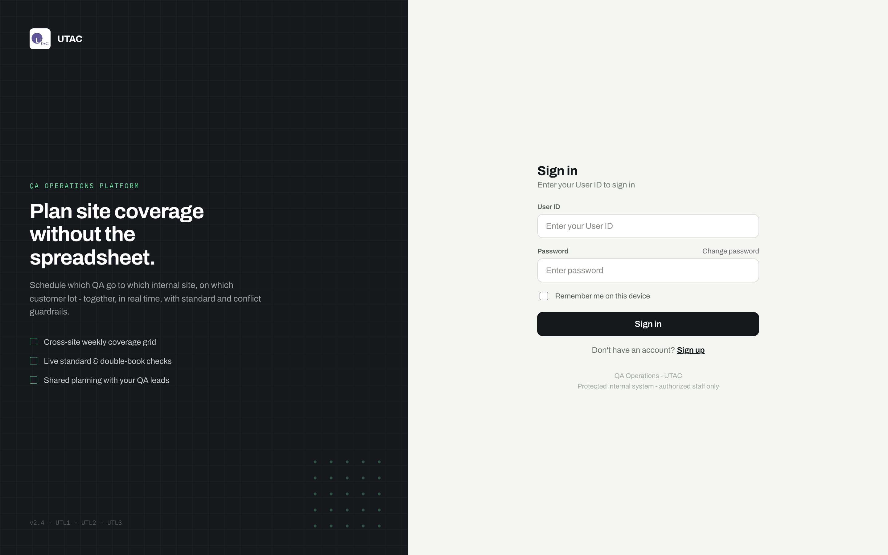
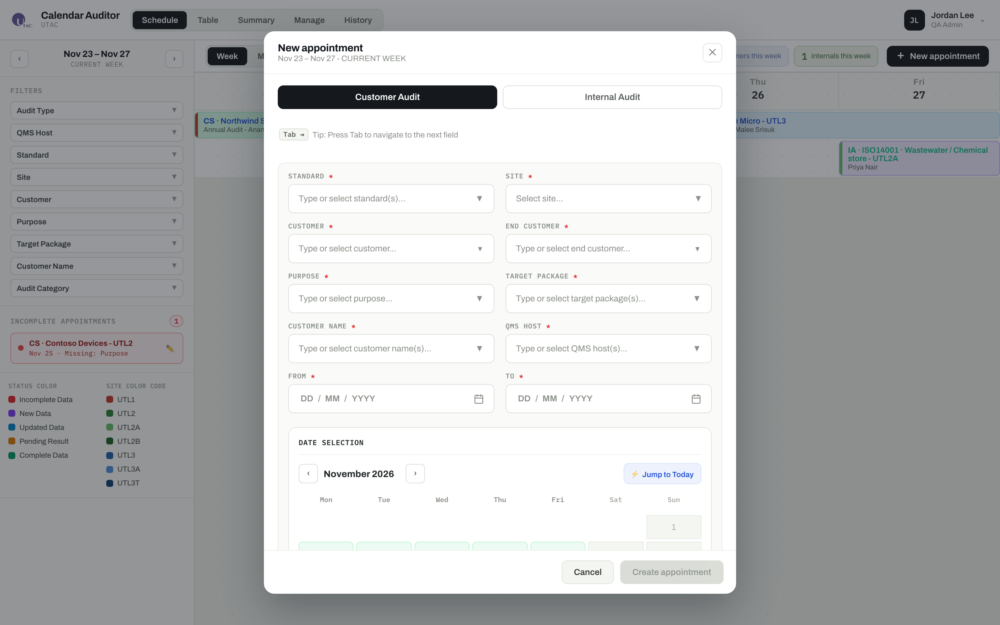
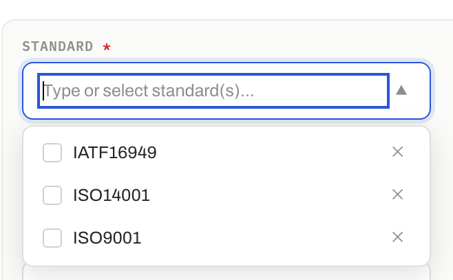

# User Guide

How to plan Customer Audits (CS) and Internal Audits (IA) in UTAC QA Calendar (QMS-CASS), shown in the app as **Calendar Auditor**, record their results, maintain the data behind them, and report on them. Part one explains how the calendar works. Part two gives step-by-step tasks for each role.

> [!NOTE]
> Roles in this guide describe who usually does a task. The app does not hide menus by role, so follow your team's approval rules before changing shared data.

## 1. Before you start

### 1.1 Browser

Use a current **Microsoft Edge** (UTAC standard) or **Google Chrome** in a standard window.

- Avoid InPrivate or Incognito windows; you will have to sign in again every time.
- Do not set the browser to clear cookies and site data on exit, or you will have to sign in every time.
- Allow downloads from the app so Excel (`.xlsx`) and CSV exports can be saved.

### 1.2 Sign in

1. Enter your **User ID** and **Password**, then select **Sign in**. The app opens **Schedule** on the current month.
2. Tick **Remember me on this device** to stay signed in for up to 30 days. Without it, your session ends when you close the browser, and after 12 hours at most.
3. New account: choose **Sign up** and fill in **User ID** (at least 3 characters: letters, digits, `.`, `_` or `-`), **Staff registration code** (from your administrator), **Password** (at least 4 characters) and **Confirm password**. The app then returns to **Sign in**; sign in with the new account.
4. To change your password, choose **Change password** and enter your current password first. Changing it ends every session for your account, so sign in again with the new password. There is no "forgot password" reset: if you forget it, ask the administrator.

### 1.3 Find your way around

The top bar has five pages: **Schedule** (calendar), **Table** (searchable records), **Summary** (yearly totals), **Manage** (QMS Hosts, options, holidays), and **History** (change log). Open the menu under your name for **Your profile** and **Sign out**. On a phone (any window narrower than 860px) the five pages sit in a bar at the bottom of the screen, and **Table** and **History** show each entry as a card; the filters in **Table** open with **Filters**. On a phone, the bar under **Week / Month / Year** shows the week, month or year you are viewing, with **Today** and arrows to move. In **Week** view, tap a day in the strip of weekdays. In **Month** view, each day shows one dot per appointment in its status color; tap a day to list its appointments under the calendar.

")

> [!WARNING]
> On a shared computer, choose **Sign out** when you finish. Signing out ends your session, but the browser keeps its copy of the calendar (appointments, customer names, notes). Do not use shared or public computers for sensitive audit records.

## 2. How the calendar works

### 2.1 Sites

The calendar covers seven sites. Each has a color used for the strip on the left edge of its cards. The current colors are under **Site Color Code** in the Schedule sidebar. Administrators can change a color, and add or remove sites, in **Manage → Options → Site** (the color square beside each site). A `Shutdown Plant` rule can lock only the seven sites below.

| Site | Default color |
|---|---|
| `UTL1` | `#c0392b` |
| `UTL2` | `#2e7d32` |
| `UTL2A` | `#66bb6a` |
| `UTL2B` | `#1b5e20` |
| `UTL3` | `#1e5fa8` |
| `UTL3A` | `#4a90d9` |
| `UTL3T` | `#123f73` |

### 2.2 Appointment status

A card's background color shows its status. The app works the status out for you; you never set it by hand.

| Color | Status | Meaning | What to do |
|---|---|---|---|
| 🔴 Red | Incomplete Data | A required field or the date range is missing | Find it under **Incomplete Appointments** in the Schedule sidebar; each entry shows "Missing: …". Click it to open the form. |
| 🔵 Blue | Updated Data | Complete, and edited in the last 7 days (saving results counts as an edit) | Check that the change is correct |
| 🟣 Purple | New Data | Complete, and created in the last 7 days | Nothing; it is a new booking |
| 🟡 Amber | Pending Result | The first day has arrived, no result above 0 is recorded, and it was not created or edited in the last 7 days | Record the results |
| 🟢 Green | Complete Data | Complete, with nothing pending | Nothing |

The app checks in the order shown: red first, then blue, purple, amber, and finally green. So an appointment created this week and then edited shows blue, not purple, and an audit whose date has passed shows purple or blue, not amber, while it is less than 7 days old.

")

### 2.3 Day rules

Day cells show whether a date accepts audits. Always read the label on the cell.

| Day cell | Rule | Customer Audit (CS) | Internal Audit (IA) |
|---|---|---|---|
| White | Normal working day | Allowed | Allowed |
| Gray | `Public Holiday` | Not booked; skipped inside a date range | Not booked; skipped inside a date range |
| Blue | `No Customer Audits` | Blocked: a CS range that includes this day cannot be saved | Allowed |
| Blue | `Shutdown Plant` | Blocked: a CS range that includes this day cannot be saved | Allowed only at sites the rule does not lock |

- Weekends and public holidays inside a date range are skipped and the other days are booked. If every day in the range is skipped, the app refuses to save. Weekend and holiday cells cannot be clicked.
- When a range includes a `No Customer Audits` or `Shutdown Plant` day, the form switches to **Internal Audit**, and sites locked by `Shutdown Plant` are removed from **Site**.
- Choosing **Reset to Normal Day** on a built-in public holiday turns it into a working day (`Working Day`).
- Holiday rules never move or delete existing appointments. An appointment on a day that later becomes a public holiday cannot be opened from Schedule; edit or delete it from **Table**.

### 2.4 Required fields

| Audit type | Required fields |
|---|---|
| Customer Audit (CS) | Standard, Site, Customer, End Customer, Purpose, Target Package, Customer Name, QMS Host, and a valid date range |
| Internal Audit (IA) | Standard, Site, Audit Category, Area, QMS Host, and a valid date range |

You can save before every field is filled, but **Create appointment** stays disabled until at least one main field has a value: for CS, one of Customer, Standard, Site, Customer Name, Purpose or QMS Host; for IA, one of Audit Category, Area, Standard, Site or QMS Host. An empty **From** date means today. An incomplete appointment stays red and is listed under **Incomplete Appointments** until you complete it.

## 3. QA Planner: plan audits

### 3.1 Create a Customer Audit (CS)

1. Open **Schedule**, choose **Month**, and use the arrows to reach the month you are planning.
2. Check the day cells. A `No Customer Audits` or `Shutdown Plant` day anywhere in the range blocks a CS; weekends and public holidays are skipped.
3. Select **New appointment**. Or click a date to open that day's list, then select **+ New Appointment**. **Customer Audit** is already selected, unless the date is a `No Customer Audits` or `Shutdown Plant` day.
4. Fill the eight CS fields and set **From** and **To**. The end date cannot be before the start date.
5. Select **Create appointment**.
6. Check that the card appears on the right days and site. If it is red, complete it from **Incomplete Appointments**.

**Customer** and **End Customer** take one value: type to search, or type a new name. **Standard**, **Site**, **Purpose**, **Target Package**, **Customer Name** and **QMS Host** (and **Area** for IA) take several values: type to filter, tick the values you want, or add a new one with **＋ Add "…"**. The **×** on a selected tag removes it from this appointment only. The **✕** beside a value in the open list deletes that value from the shared option list for everyone.

### 3.2 Create an Internal Audit (IA)

1. Pick a normal day, a `No Customer Audits` day, or a `Shutdown Plant` day whose rule does not lock your site.
2. Select **New appointment**, or click the date and select **+ New Appointment**, then choose **Internal Audit**.
3. Fill the five IA fields and the date range. In **Area**, select several values or add a new one; multiple areas are shown joined with ` / `.
4. Select **Create appointment** and check the card.

### 3.3 Find, edit, or delete an appointment

1. Narrow the calendar with the sidebar filters: **Audit Type**, **QMS Host**, **Standard**, **Site**, **Customer**, **Purpose**, **Target Package**, **Customer Name**, **Audit Category**. **Clear all** removes them. Filters change only what you see.
2. Click a day to open its list. Each card has **Audit Results** (clipboard icon), an eye to show its details, ✏️ to edit, and ✕ to delete.
3. For a multi-day appointment, Schedule asks: **Edit this day only** or **Edit entire appointment**, and **Delete this day only** or **Delete entire appointment**. When you edit one day, **From** and **To** are locked.
4. Select **Save changes**, then check the day, site, and status.

> [!NOTE]
> In **Table**, each row is one day. ✕ on a day of a multi-day appointment offers **This day** (delete only that day) or **All N days** (delete the whole appointment); a one-day appointment shows **Delete**.

")

## 4. QMS Host: review and record results

### 4.1 Review your audits

1. Open **Schedule** and filter by your name under **QMS Host** and by your **Site**.
2. Check the date, site, audit type, Standard, and Customer (CS) or Area (IA).
3. If something is wrong, tell the QA Planner rather than changing it without approval.
4. Before an IA on a `Shutdown Plant` day, confirm your site is not locked.

### 4.2 Record results

1. Open the appointment and select the **Audit Results** icon.
2. Enter **Major**, **Minor**, **OFI**, **OBS** and **Finding(s)** for each site. The rows cover every site in the series (one **General** row if there is no site).
3. Check the numbers and the site, then select **Save Results**. Results apply to the whole multi-day series.
4. For handover remarks, expand the card and use **NOTES**. A note belongs to that day only and does not record who wrote it or when (every note shows "You" and "just now"), so put your name and the date in the text.
5. After **Save Results** the card turns blue for 7 days, then green.

> [!IMPORTANT]
> **Save Results** records a result even when every count is 0, so an audit with no findings turns green. **Clear Results** removes the result, and the card goes back to amber. Results saved as all zeros with an older version of the app still count as "no result": open **Audit Results** and select **Save Results** again.

> [!TIP]
> If results disappear after a refresh, read any warning message and tell the QA Planner or administrator before entering them again. Repeating the entry can create duplicates.

## 5. QA Admin: maintain hosts, options, and holidays

### 5.1 QMS Hosts

1. Open **Manage → QMS Host**.
2. Filter by **Site**, **Standard**, or **Department** to find the right person.
3. Select **New QMS Host** to add someone, or click a row to edit **Name**, **Site**, **Standard** (Internal Audit / Customer Audit) and **Department** (QA / Non-QA). Save with **Create QMS Host** or **Save Changes**. Renaming a host also renames them on their existing appointments.
4. To remove a host, first reassign their appointments: the app refuses to remove a host who is on any appointment, past or future.

You can drag rows, but the new order is not saved: it resets on reload and others do not see it.

")

### 5.2 Form options

1. Open **Manage → Options**. Every group is listed: **Site** (with its color square), **Standard** (Internal Audit and Customer Audit), **Customer**, **End Customer**, **Purpose**, **Target Package**, **Customer Name** and **Audit Category**.
2. Add a value with the text box and **+ Add** (or Enter). Drag values to reorder them; remove one with **✕**. Check spelling and duplicates first.
3. The app refuses to remove a value while any appointment uses it (every group except Audit Category). Deleting the last appointment that uses a Customer, End Customer, Purpose or Audit Category also removes that value from Options.

### 5.3 Holidays and restrictions

1. Open **Manage → Holidays**. Change the year with the arrows, or type a four-digit year and press Enter.
2. Click a date, or select **Add Date Range Rule**. In **Configure Calendar Status**, choose **Public / General Holiday**, **Shutdown Plant**, or **No Customer Audits**. New rules start as No Customer Audits, so check the choice.
3. For `Shutdown Plant`, tick the sites to lock under **Affected Sites (Shutdown)**. None are ticked by default; use **Select All** if every site is affected. **Save Status** stays disabled until at least one site is ticked.
4. Fill **Holiday name / note** (optional), check the dates, rule and sites, then select **Save Status**.
5. Select the **Public Holidays** card to see the year's holidays in date order. Use **Reset to Normal Day** to clear a date's rule.

")

> [!NOTE]
> There is no Excel or CSV holiday import. Add rules on the calendar or with **Add Date Range Rule**.

## 6. Reports: search, export, and history

### 6.1 Table and export

1. Open **Table**. Search by text, or use the filters **All Audits / Customer Audit / Internal Audit**, **All Sites**, **All Standards**, **All Audit Categories**, **All Target Packages**, **All Customers**, **All QMS Hosts**, and the **From / To** dates.
2. Click a column heading to sort; click again to reverse. **Reset filters** clears everything.
3. Check the count in the header ("N audits · M scheduled days"), then select **Export Excel** or **Export CSV**. The file holds every filtered row in the current sort order, across all pages, one row per scheduled day: Date, Audit Type, Customer, Site, Standard, Audit Category, Purpose (Area for IA), Target Package, Customer Name and QMS Host. End Customer, results and notes are not included.
4. Open the file and check the headers, row count, and a sample site before you share it.

")

### 6.2 Summary

Open **Summary** for the year's totals: audits, customer visits by site and month, and findings by site. Choose the year with the arrows or the year box.

- **Audit Visits by Site → Export to Excel** downloads `audit-visits-YEAR.xlsx` (Customer Audit site-days only).
- **Audit Findings by Site → Export to Excel** offers **Export All Sites (Full Matrix)**, **Export Summary Only**, or one site.

")

### 6.3 History

Open **History** to see what everyone changed: appointments, results, options, and holiday rules. The server records who made each change and when, so the name shown is the account that was signed in. Filter by text, **Action**, **Entity**, and date range; times are shown in your local time. History first loads the latest 200 changes; select **Load older changes** at the bottom for earlier ones (the filters search the changes loaded). Changes to the QMS Host list in Manage are not recorded. If something looks wrong, note the time and record and contact the QA Admin.

> [!NOTE]
> An entry marked **This browser only** is stored only on this computer: it was recorded before History moved to the server, or it could not be saved there (a warning appears when that happens). Colleagues do not see it, and clearing browser data erases it.

")

> [!WARNING]
> Exported workbooks can contain customer names and audit details. Store and share them under UTAC's data-handling rules.

## 7. End-of-day checklist

- **QA Planner:** no red cards left; new and updated bookings have the right dates and hosts.
- **QMS Host:** results recorded for finished audits; pending ones have an owner and follow-up date.
- **QA Admin:** master-data and holiday requests checked against the right sites and dates.
- **Report user:** filters and period confirmed before sharing any export.
- **Everyone:** sign out on shared computers.

## 8. Troubleshooting

| Problem | What to check |
|---|---|
| An appointment is missing | Month or year, view (Week / Month / Year), and active filters; try **Clear all**. Month view shows at most 3 cards per day plus "+N more". |
| A card is red | **Incomplete Appointments** in the Schedule sidebar shows "Missing: …" for it. |
| Cannot book a CS | A `No Customer Audits` or `Shutdown Plant` day somewhere in the range, or every day in the range is a weekend or public holiday. |
| Cannot book an IA | Every day is a weekend or public holiday, or a `Shutdown Plant` day in the range locks one of your sites. |
| Cannot open an appointment from Schedule | Its day became a public holiday. Open it from **Table**. |
| Data looks out of date, or every change shows "A change could not be saved to the shared calendar" | Your session has ended (browser closed without Remember me, the 12-hour or 30-day limit, or a password change), but the app kept showing this browser's copy. Choose **Sign out**, then sign in again. |
| A change disappeared after refresh | Read the warning and check your connection; report it before retrying. |
| Export does not match | Filters, date range, year, and result count. |
| Sign-in screen appears every time | InPrivate/Incognito, or the browser clears site data on exit. |
| Cannot sign in or sign up | Check User ID and password. Ask the administrator for a registration code, or to reset a forgotten password. |

When you report a problem, include the page, the time, the site, and what you did. Remove customer details from screenshots.
