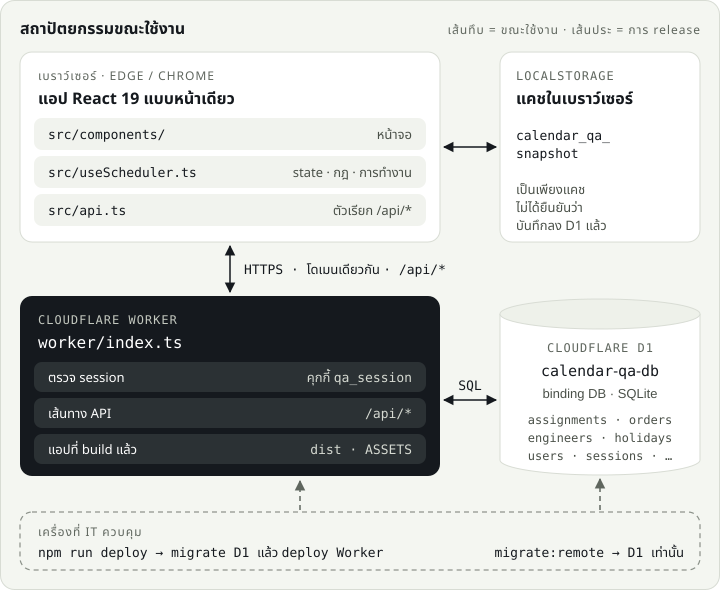

# คู่มือนักพัฒนา

อธิบายว่า UTAC QA Calendar (QMS-CASS) สร้างอย่างไร รันในเครื่องอย่างไร และแก้ไขอย่างไรโดยไม่ทำให้การเชื่อมต่อระหว่างหน้าจอ กฎธุรกิจ API และฐานข้อมูลเสียหาย เรื่องการดูแลระบบจริง (เจ้าของระบบ การ release การกู้คืน และการทบทวนความปลอดภัย) อยู่ใน [คู่มือส่งมอบ IT](it-handover.md)

> [!CAUTION]
> `npm run deploy` และ `npm run migrate:remote` เปลี่ยน Worker และฐานข้อมูลจริง ให้ทำงานกับ local D1 และรันคำสั่ง production เฉพาะเมื่อได้รับอนุมัติจาก IT และเจ้าของข้อมูล QA

## 1. สถาปัตยกรรม

แอปเป็น single-page app ด้วย React 19 และ TypeScript ที่ build ด้วย Vite มี Cloudflare Worker ตัวเดียวทำหน้าที่ให้บริการไฟล์ที่ build แล้วและ API `/api/*` ข้อมูลที่ใช้ร่วมกันเก็บใน Cloudflare D1 (SQLite)



| ส่วน | ตำแหน่ง | หน้าที่ |
|---|---|---|
| หน้าจอ | `src/components/` | แสดงผลและเรียก callback จาก view model |
| ศูนย์กลาง state | `src/useScheduler.ts` | state, navigation, filter, validation, สร้าง/แก้/ลบ และ view model (`VM`) |
| กฎธุรกิจ | `src/types.ts`, `src/holidays.ts`, `src/utils/` | types, normalization, ฟิลด์บังคับ, สถานะ, กฎวัน, metrics, ตัวเลือก dropdown |
| API client | `src/api.ts`, `src/utils/authClient.ts` | เรียก `/api/*` แบบ same-origin, sign-in และ session |
| Worker | `worker/index.ts` | ตรวจ session, routing API, SQL กับ D1, fallback ไปยังไฟล์ static |
| Schema | `migrations/*.sql` และ `ensure*()` ใน `worker/index.ts` | migration ของ D1 ตามลำดับ และ Worker ยังแก้ schema บางส่วนตอน runtime ด้วย (ดู 4.1) |
| Config | `wrangler.toml` | ชื่อ Worker, asset binding `dist`, D1 binding |

## 2. รันในเครื่อง

### 2.1 ติดตั้ง

ใช้ **Node.js 22.12 ขึ้นไป** (Wrangler ต้องใช้ 22+ ส่วน Vite และ oxlint ต้องใช้ 22.12+) แล้วรันจาก root ของ repository:

```bash
npm ci
```

### 2.2 เฉพาะ frontend

```bash
npm run dev
```

Vite ที่ `http://localhost:5173` เหมาะกับงาน layout และ component โหมดนี้ไม่มี Worker, D1 หรือ proxy สำหรับ `/api`:

- การ sign-in จะใช้บัญชีที่เก็บในเบราว์เซอร์แทน (เฉพาะ development build) ให้สร้างบัญชีผ่าน **Sign up**
- ข้อมูลมาจาก `calendar_qa_snapshot` ใน `localStorage` (cache เดียวกับที่ production ใช้) ปฏิทินจึงเริ่มต้นแบบว่าง
- จะเห็น banner "Could not load the shared calendar" ตอนโหลด และ banner บันทึกไม่สำเร็จทุกครั้งที่แก้ไข เพราะไม่มีการให้บริการ `/api/*`

### 2.3 Worker พร้อม local D1

1. apply migration กับฐานข้อมูลในเครื่อง**ก่อน**เริ่ม Worker (ดูข้อ 9 ขั้นตอนที่ 3):

   ```bash
   npm run migrate:local
   ```

2. หากต้องทดสอบการสมัคร ให้สร้างไฟล์ `.dev.vars` ที่ root ของ repository (ไฟล์นี้ไม่ถูก track ใน git):

   ```dotenv
   REGISTRATION_CODE=any-local-test-value
   ```

3. build และเริ่ม Worker:

   ```bash
   npm run dev:worker
   ```

   Wrangler จะแสดง URL ในเครื่อง

> [!WARNING]
> ห้ามใส่ registration code ของ production, Cloudflare token หรือข้อมูลลูกค้าจริงใน `.dev.vars`, source code, log หรือภาพหน้าจอที่ commit และห้ามชี้การพัฒนาในเครื่องไปที่ D1 ของ production

### 2.4 คำสั่ง

| คำสั่ง | ทำอะไร |
|---|---|
| `npm run dev` | Vite dev server เฉพาะ frontend |
| `npm run dev:worker` | build แล้ว `wrangler dev` กับ local D1 |
| `npm run build` | ตรวจ type (`tsc -b`) และ bundle ด้วย Vite |
| `npm run lint` | `oxlint` |
| `npm test` | regression test การแยกประเภท Customer / Internal Audit และเกณฑ์ว่าการตรวจใดนับว่ามีผลตรวจแล้ว |
| `npm run preview` | ดูตัวอย่าง production build |
| `npm run migrate:local` | apply migration กับ local D1 |
| `npm run migrate:remote` | apply migration กับ D1 ใน `wrangler.toml` (production) |
| `npm run deploy` | release (`scripts/deploy.mjs`): build แสดงรายการ D1 migration ที่ค้างอยู่และขอให้ยืนยัน แสดงจุดกู้คืน (restore point) ของ Time Travel แล้ว apply migration เหล่านั้น จากนั้น `wrangler deploy` หากปฏิเสธหรือ migration ล้มเหลว จะหยุดก่อน deploy โค้ด ใช้ `-- --local` เพื่อซ้อมกับ local D1 โดยไม่ deploy |
| `npm run docs` | สร้างเอกสาร HTML ใหม่ (รวมถึง search index) จากไฟล์ Markdown เหล่านี้ |
| `npm run docs:screenshots` | ถ่ายภาพหน้าจอสำหรับเอกสารใหม่จากแอปที่รันอยู่ |

## 3. แอปเริ่มทำงานอย่างไร

1. `src/main.tsx` mount `<App />` แล้ว `src/App.tsx` เรียก `useScheduler()` และแสดง Login หรือแอป
2. `initialState()` ใน `src/data.ts` โหลดค่าเริ่มต้น browser snapshot (`calendar_qa_snapshot`) บันทึกที่เก็บไว้ (`calendar_qa_comments`) และผู้ใช้ที่จำไว้ (`calendar_qa_session_user`) หากมีผู้ใช้ที่จำไว้ แอปจะเปิดขึ้นในสถานะ sign-in แล้ว เดือนและปีมาจาก `getCurrentCalendarDefaults(new Date())`
3. `useScheduler()` ตรวจ session ฝั่งเซิร์ฟเวอร์ด้วย `authClient.getSession()` (`GET /api/auth/session` ตรวจ HttpOnly cookie กับ D1) หาก session หมดแล้ว (401) แอป**ยังคง**ใช้ตัวตนที่จำไว้และ snapshot ใน cache และไม่โหลดข้อมูลจากเซิร์ฟเวอร์ หลังจากนั้นการบันทึกทุกครั้งจะล้มเหลวจนกว่าผู้ใช้จะ sign out แล้ว sign in ใหม่
4. เมื่อ session ใช้ได้ จะเรียก `api.fetchState()` (`GET /api/state`) หนึ่งครั้ง Worker อ่าน engineers, plants, active plants, orders, assignments, comments, แถว `activity` 50 แถวล่าสุด, options, holidays และรายการ History 200 รายการล่าสุดพร้อมกัน ไม่มีการ polling การเปลี่ยนแปลงของผู้ใช้อื่นจะเห็นหลัง reload
5. client normalize ข้อมูล (`normalizeAssignment`, `normalizeSite` ฯลฯ) และอัปเดต snapshot จากจุดนี้ D1 เป็นแหล่งข้อมูลหลัก snapshot เป็นเพียง cache หน้า History แสดงรายการจากเซิร์ฟเวอร์ รวมถึงรายการที่เบราว์เซอร์นี้บันทึกไม่สำเร็จ (มีป้าย "This browser only") และเก็บใน cache เฉพาะรายการที่ยังบันทึกไม่สำเร็จเหล่านั้น

หากหน้าจอว่าง ให้ตรวจว่าอยู่ในโหมดใด (Vite อย่างเดียว หรือ Worker + D1) เข้าสู่ระบบแล้วหรือยัง และดูใน DevTools ว่า `/api/auth/session` และ `/api/state` ตอบอะไร

## 4. โครงสร้างข้อมูล

### 4.1 ตารางใน D1

| ตาราง | คีย์ | เก็บอะไร |
|---|---|---|
| `assignments` | `id` | หนึ่งแถวต่อหนึ่งวันของนัดหมายที่จองได้: `audit_type` (`customer`, `internal` หรือ `''` = ไม่ทราบ ถือเป็น CS) ไซต์ ลูกค้า purpose ฟิลด์การตรวจ ผลตรวจ (แยกตามไซต์; `recorded: true` ระบุว่าผลตรวจถูกบันทึกแล้ว ดังนั้นแม้จำนวนเป็น 0 ทั้งหมดก็ยังนับว่ามีผลตรวจ) timestamps มี foreign key ไปที่ `engineers.id` (`eng`) และ `orders.id` (`order_id`) |
| `orders` | `id` | หนึ่งแถวต่อหนึ่งนัดหมาย ทุกวันของนัดหมายใช้แถวเดียวกัน จึงเป็นตัวเชื่อมชุดนัดหมาย `product` เก็บ end customer (CS) หรือ area (IA); `plant` เก็บไซต์ (CS) หรือ standard (IA) |
| `engineers` | `id` | QMS Host: ชื่อ บทบาท แผนก แผนกย่อย รวมถึง `site` และ `host_department` ระบบสร้างแถวให้อัตโนมัติเมื่อพิมพ์ชื่อ host ใหม่ในฟอร์ม |
| `comments` | `id` | บันทึกของวัน เชื่อม `assignments` ด้วย `assignment_id` ไม่ได้บันทึกผู้เขียนและเวลา (แสดงเป็น "You", "just now" เสมอ) |
| `plants` / `active_plants` | `id` / `plant_id` | ข้อมูล plant แบบเก่าของ QMS / EHS / ESD และ flag สถานะเปิดใช้ ไม่มีหน้าจอใดใช้ |
| `options` | `(category, value)` | ค่าของ dropdown ไซต์คือแถว `site_code` ที่เก็บสีไว้ใน `meta` ลำดับที่กำหนดเองเก็บเป็น JSON ในแถว `_order_<category>` |
| `custom_holidays` | `date` | กฎวันหยุด shutdown no-customer-audit และ working-day พร้อมไซต์ที่ล็อก |
| `activity` | `id` | activity feed แบบเก่า (แสดงในหน้า Profile) และแถว audit ของการเปลี่ยนวันหยุด โดยระบุบัญชีที่ sign-in อยู่ หน้า History ไม่ได้ใช้ตารางนี้ |
| `history_log` | `id` | History ที่ใช้ร่วมกัน (migration `0021`): หนึ่งแถวต่อหนึ่งการเปลี่ยนแปลง โดย Worker กำหนดผู้ใช้และเวลาจาก session ส่วน action, entity, คำอธิบาย และ metadata มาจากเบราว์เซอร์ |
| `users` | `id` | ชื่อผู้ใช้ hash และ salt ของรหัสผ่าน ชื่อที่แสดง บทบาท |
| `sessions` | `token_hash` | session ฝั่งเซิร์ฟเวอร์ (เชื่อม `users` เชิงตรรกะ ไม่มี foreign key) แถวที่หมดอายุแล้วไม่ถูกลบทิ้ง |

อ่าน migration ตามลำดับเลขตั้งแต่ `0001_init.sql` ห้ามแก้ migration ที่อาจ apply ไปแล้ว ให้เพิ่มไฟล์หมายเลขถัดไป

Worker ยังแก้ schema ตอน runtime ด้วย: ใน request แรกของ Worker instance แต่ละตัว `ensureAssignmentColumns()`, `ensureUsersTable()`, `ensureSessionsTable()` และ `ensureCustomHolidaysTable()` จะเพิ่มคอลัมน์และตารางที่ยังไม่มี `assignments.department`, `engineers.site` และ `engineers.host_department` มีอยู่**เฉพาะ**ผ่านฟังก์ชันเหล่านี้ นอกจากนี้ `ensureSessionsTable()` ยังลบผู้ใช้ demo เก่า และเลื่อนบัญชีที่เก่าที่สุดขึ้นเป็น admin เมื่อยังไม่มี admin ทุกครั้งที่ cold start

### 4.2 นัดหมายหลายวัน

นัดหมายที่ครอบคลุมหลายวันคือหลายแถวใน `assignments` หนึ่งแถวต่อหนึ่งวันธรรมดาที่จองได้ (ข้ามวันหยุดสุดสัปดาห์และวันหยุดนักขัตฤกษ์ตอนสร้างแถว) แถวเหล่านี้เชื่อมกันด้วย `order_id` ที่ใช้ร่วมกัน (และ `eng`) client ยังกำหนด `seriesId` / `groupId` ด้วย แต่ค่าเหล่านี้**ไม่ได้**ถูกบันทึก หลัง reload จึงหาชุดนัดหมายจาก `order` + `eng` การแก้หรือลบทุกครั้งต้องรองรับทั้ง "เฉพาะวันนี้" และ "ทั้งชุด" ผลตรวจเก็บแยกตามไซต์ใน `results` และ normalize ด้วย `normalizeAuditResults()` โดยใช้ร่วมกันทั้งชุด

## 5. API

ทุก route อยู่ใต้ `/api/` แบบ same-origin Worker ตอบ request ข้าม origin (ตรวจ Origin หรือ `Sec-Fetch-Site`) ด้วย 403 "Cross-origin request denied." ทุก route ต้องมี session ที่ใช้ได้ ยกเว้น `auth/session` (ตอบ 401 เอง), `auth/logout`, `auth/login`, `auth/register` และ `auth/reset-password` ส่วน alias `auth/signin`, `auth/signup` และ `auth/reset` ทำงานเหมือนกัน

| Route | Methods | หน้าที่ |
|---|---|---|
| `auth/session` | `GET` | session ปัจจุบัน |
| `auth/login` | `POST` | เข้าสู่ระบบ |
| `auth/register` | `POST` | สมัคร ต้องใช้ `REGISTRATION_CODE` (ตอบ 403 หากไม่ได้ตั้งค่าไว้) |
| `auth/reset-password` | `POST` | เปลี่ยนรหัสผ่านโดยใช้รหัสผ่าน**ปัจจุบัน** (ไม่มีการรีเซ็ตกรณีลืมรหัสผ่าน) และยกเลิกทุก session ของบัญชี |
| `auth/logout` | `POST` | ยกเลิก session ปัจจุบัน |
| `state` | `GET` | ข้อมูลทั้งหมดที่แอปใช้ตอนเริ่ม |
| `assignments` · `assignments/:id` | `GET` `POST` · `PUT` `DELETE` | วันของนัดหมาย `PUT` จะ merge body บางส่วนเข้ากับแถวที่เก็บไว้ |
| `orders` · `orders/:id` | `GET` `POST` · `PUT` `DELETE` | Orders `DELETE` จะลบ assignment ทุกแถวที่เชื่อมอยู่และ comment ของแถวเหล่านั้นด้วย |
| `engineers` · `engineers/:id` | `GET` `POST` · `PUT` `DELETE` | QMS Host `DELETE` จะลบ assignment ทุกแถวที่เชื่อมอยู่และ comment ของแถวเหล่านั้นด้วย |
| `plants` · `plants/:id` · `plants/:id/toggle` | `GET` `POST` · `DELETE` · `POST` | plant แบบเก่า (UI ไม่ได้ใช้) |
| `comments` · `comments/:id` | `POST` · `DELETE` | บันทึกของวัน |
| `history` | `GET` `POST` | History ที่ใช้ร่วมกัน `GET` คืนค่าทีละหน้าโดยเรียงจากใหม่ไปเก่า (`before`, `beforeId`, `limit` สูงสุด 500 ค่าเริ่มต้น 200) `POST` เก็บหนึ่งรายการ โดย Worker กำหนดผู้ใช้และเวลา และตรวจชื่อ action และ entity |
| `activity` | `POST` | activity feed แบบเก่า |
| `options` · `options/reorder` | `POST` `DELETE` · `PUT` | ค่าของ dropdown และลำดับ |
| `holidays` · `holidays/:date` · `holidays/reset` | `GET` `POST` `DELETE` · `DELETE` · `POST` | กฎวัน ลบหลายรายการ รีเซ็ตทั้งปี ทุกการเปลี่ยนแปลงจะเขียนแถว `activity` |

session ใช้ cookie `qa_session` แบบ HttpOnly (`SameSite=Lax` และ `Secure` เฉพาะเมื่อใช้ HTTPS) เมื่อเลือก **Remember me** cookie จะอยู่ได้ 30 วัน หากไม่เลือก cookie จะไม่มีวันหมดอายุ จึงหมดไปเมื่อปิดเบราว์เซอร์ และเซิร์ฟเวอร์จะให้หมดอายุหลัง 12 ชั่วโมง ค่าคงที่อยู่ต้นไฟล์ `worker/index.ts` response 500 จะส่งข้อความ exception ดิบกลับไป และ Worker ไม่ได้ log ไว้

## 6. กฎธุรกิจ

กฎแต่ละข้อมีที่อยู่เดียวในโค้ด ให้แก้ที่นั่น ไม่ใช่ใน component

| กฎ | ตำแหน่ง |
|---|---|
| 7 ไซต์ `UTL1` `UTL2` `UTL2A` `UTL2B` `UTL3` `UTL3A` `UTL3T` และ normalize ค่าเก่า | `normalizeSite()` / `normalizeSites()` ใน `src/types.ts`; `MASTER_PLANT_SITES` ใน `src/utils/auditOptionsHelper.ts` |
| ประเภท Customer หรือ Internal Audit: เก็บใน `audit_type` (migration `0020`) หากไม่มีค่า ให้ตัดสินจากเนื้อหา: มีฟิลด์ลูกค้า → CS, มี area / audit category → IA ห้ามใช้ `site2`, `auditor2`, `department2` เพราะเป็นค่าสำเนาเพื่อความเข้ากันได้ที่มีในทุกแถว id, order, code หรือ title ที่ขึ้นต้นด้วย "IA" ก็ถือเป็น IA เช่นกัน | `isInternalAssignment()` ใน `src/types.ts` ทดสอบด้วย `npm test` |
| CS ต้องมี 8 ฟิลด์ IA ต้องมี 5 ฟิลด์ และทั้งคู่ต้องมีช่วงวันที่ที่ถูกต้อง | `getMissingFields()` และ `isAppointmentFormIncomplete()` ใน `src/types.ts` |
| สถานะ: Incomplete → Updated → New → Pending Result → Complete ด้วยกรอบเวลา 7 วัน การตรวจนับว่ามีผลตรวจเมื่อบันทึกผลตรวจของไซต์แล้ว (`recorded: true` ซึ่งตั้งโดย **Save Results**) หรือมีจำนวนใดมากกว่า 0 ส่วน **Clear Results** จะบันทึกค่า 0 โดยไม่มี flag นี้ | `resolveAuditStatus()`, `isAuditResultCompleted()` และ `STATUS_COLOR_MAP` ใน `src/types.ts` |
| สีพื้นและขอบการ์ดมาจากสถานะ (`getApptCardColors()`) แถบซ้ายมาจากสีไซต์ (`siteColorsOfAssignment()` + `getAccentStyle()`) | `src/useScheduler.ts`; สีไซต์คือ `initialSiteColors` (`src/data.ts`) ที่ถูกทับด้วยตัวเลือก `site_code` จาก D1 แก้ได้ที่ Manage → Options → Site |
| Public Holiday และวันหยุดสุดสัปดาห์ถูกข้ามออกจากช่วงวันที่; No Customer Audits ปิด CS; Shutdown Plant ปิด CS ทุกไซต์ และปิด IA เฉพาะไซต์ที่ล็อก; Working Day ยกเว้นวันหยุดในตัว (built-in) | `src/holidays.ts` บังคับใช้**เฉพาะในเบราว์เซอร์** ใน `submitCreate()` / `submitEdit()` การลากย้าย (drag-move), duplicate, copy-week และ Worker ไม่ได้ตรวจกฎเหล่านี้ |
| ตัวเลือก dropdown มาจากนัดหมายที่ใช้งานอยู่ ยกเว้น Site (รายการคงที่) | `getActiveDropdownOptions()` ใน `src/utils/auditOptionsHelper.ts` |
| วันที่มีประเภท entity ไซต์ และ purpose เดียวกัน นับเป็นการตรวจ 1 ครั้งเมื่อห่างกันไม่เกิน 1 วันตามปฏิทิน (ดังนั้นศุกร์ → จันทร์นับเป็น 2 ครั้ง และวันหยุดจะตัดช่วงต่อเนื่องออกจากกัน) สำหรับ IA entity คือ standard / category / area และ purpose คือ area | `calculateAuditStats()` ใน `src/utils/auditMetricsHelper.ts` (`calculateUnifiedAuditMetrics` เป็น alias) |
| ข้อความรองของการ์ด: "purpose - host" หากไม่มี host การ์ดจะแสดง "purpose - Unassigned" และแสดง "Unassigned" เมื่อไม่มีทั้งสองค่า | `formatCardSubtitle()` ใน `src/types.ts` |
| ตัวคั่นฟิลด์หลายค่า: Site `/`; Standard, QMS Host, Purpose, Target Package, Customer Name `, `; Area ` / ` ส่วน Worker รวม array `qmsHost` ด้วย `, ` และ array `standard` ด้วย `/` | ฟิลด์ในฟอร์มอยู่ใน `AppointmentFormFields.tsx`; normalizer อยู่ใน `src/types.ts` |

## 7. การแก้ไขระบบ

### 7.1 แก้หน้าจอ

1. หา component ที่ render หน้านั้นจาก `src/App.tsx`
2. ตาม props กลับไปที่ `VM` ที่ `useScheduler()` คืนค่า
3. markup และ interaction อยู่ใน component, state และ action อยู่ใน hook, กฎร่วมอยู่ใน domain helper
4. ตรวจหน้าจอกว้างและแคบ สถานะ loading, empty, error และ keyboard focus เมื่อกว้างน้อยกว่า 860px (`vm.isMobile`) แอปใช้ layout สำหรับโทรศัพท์: `BottomNav` แทนแท็บใน header การ์ดแทนตารางใน Table และ History แถบช่วงเวลาพร้อม Today และลูกศรใน toolbar ของ Schedule (`PhonePeriodBar`, `goToday`) และในมุมมอง Month เป็นตารางจุดพร้อมรายการของวันที่เลือกด้านล่าง (`MonthMobile`, `monthAgenda`) บนหน้าจอสัมผัส ให้ใส่ class `tap`, `tap-square` หรือ `tap-hit` จาก `src/index.css` กับปุ่มต่าง ๆ เพื่อให้มีขนาดอย่างน้อย 44px

### 7.2 เพิ่มฟิลด์ในนัดหมาย

แก้ให้ครบทั้งเส้นทาง จากบนลงล่าง:

1. type และความหมาย: `Assignment`, `CreateDraft`, `EditDraft` ใน `src/types.ts` และ `normalizeAssignment()`
2. ค่าเริ่มต้นและ hydration: `src/data.ts`, `src/useScheduler.ts`
3. control ในฟอร์ม: `AppointmentFormFields.tsx` ทั้ง CS และ IA ทั้งสร้างและแก้ไข รวมถึงส่วนที่สร้าง object ใน `submitCreate()` / `submitEdit()` และ draft ที่ `openEdit()` เติมค่าให้
4. validation: `getMissingFields()` หากเป็นฟิลด์บังคับ และตัดสินว่าฟิลด์มีผลต่อสถานะสีแดงหรือไม่
5. API: `src/api.ts` และใน Worker คือ `assignmentOut()` กับรายการคอลัมน์ที่ระบุไว้ชัดเจนใน `INSERT` / `UPDATE` ของ `assignments`
6. migration ใหม่ `migrations/0021_<name>.sql` (ใช้หมายเลขถัดไปที่ว่าง) ทดสอบกับ local D1 ที่มีข้อมูลเดิม **อย่า**เพิ่มคอลัมน์นั้นใน `ensureAssignmentColumns()` ซ้ำอีก (ดูข้อ 9)
7. การ์ดและรายละเอียด ตัวกรอง Table Summary และ export History ตามที่เกี่ยวข้อง
8. คู่มือผู้ใช้และคู่มือนักพัฒนา

อย่าเพิ่มฟิลด์ในฟอร์มโดยไม่มีเส้นทาง API และฐานข้อมูล และอย่าทำให้แถวเก่าที่ฟิลด์ว่างอ่านไม่ได้

### 7.3 เพิ่ม API route

1. กำหนด type ของ request และ response แล้วเพิ่ม method ใน `src/api.ts`
2. เพิ่ม route ใน `handleApi()` ใน `worker/index.ts` ตรวจ method, payload และกรณีผิดพลาด
3. bind ค่าจาก request ทุกค่าด้วย `DB.prepare(...).bind(...)` ห้ามต่อ SQL จาก string
4. จำไว้ว่า `admin` ยังไม่ถูกบังคับฝั่งเซิร์ฟเวอร์ (ดู [คู่มือส่งมอบ IT](it-handover.md#4-ข้อค้นพบด้านความปลอดภัย)) และ Worker ไม่ได้ตรวจฟิลด์บังคับ ให้เพิ่มการตรวจเองหาก route ต้องใช้

### 7.4 เปลี่ยนสีหรือกฎสถานะ

แก้ `resolveAuditStatus()` และ `STATUS_COLOR_MAP` ใน `src/types.ts` และ `getApptCardColors()` สำหรับสีพื้น แถบซ้ายต้องเป็นสีไซต์เสมอ ไม่ใช่สีสถานะ ตรวจ legend ในแถบด้านข้าง Schedule Table การ์ดแบบย่อ และคู่มือเหล่านี้

### 7.5 เปลี่ยนกฎวันหยุด

ต้องแก้ให้ครบทุกชั้น:

- หน้า Manage (`HolidaysPanel.tsx`) และ `src/holidays.ts` รวมถึงตารางในตัว `FIXED_ANNUAL_HOLIDAYS` และ `LUNAR_BUDDHIST_HOLIDAYS` (วันตามจันทรคติกำหนดไว้เฉพาะปี 2026–2028)
- validation ใน `submitCreate()` / `submitEdit()` และจุดใน `src/useScheduler.ts` ที่ป้องกันไม่ให้คลิกช่องวันหยุด
- route `custom_holidays` และ whitelist ของประเภทวันใน Worker รวมถึง `CustomHolidayType` (`src/holidays.ts`, `src/api.ts`)

การเปลี่ยนสีช่องวันอย่างเดียวไม่ได้เปลี่ยนสิ่งที่จองได้

### 7.6 เปลี่ยนการส่งออกไฟล์

export อยู่ใน `TableView.tsx` (`handleExportExcel`, `handleExportCSV`) และ `SummaryDashboard.tsx` (`handleExportVisitsExcel`, `handleExportFindingsExcel`) ไฟล์ Excel สร้างในเบราว์เซอร์ด้วย `xlsx-js-style` ซึ่งโหลดเมื่อต้องใช้ ส่วน package `xlsx` ใน `package.json` ไม่ได้ถูก import ตรวจว่า export ตามตัวกรอง ปี ไซต์ และลำดับคอลัมน์ปัจจุบัน แล้วเปิดไฟล์จริง

### 7.7 เพิ่มไซต์

รหัสไซต์ถูก hard-code ไว้หลายที่ ให้แก้ให้ครบทุกที่ แล้วรัน `npm run build`:

1. `MASTER_PLANT_SITES` (`src/utils/auditOptionsHelper.ts`), `SITE_ORDER` (`src/types.ts`), `initialSiteCodeOptions` และ `initialSiteColors` (`src/data.ts`), `SHUTDOWN_SITE_OPTIONS` (`src/holidays.ts`)
2. pattern ของ `normalizeSite` ใน `src/types.ts` และ `worker/index.ts` รวมถึง `cleanSite` ใน `src/utils/auditMetricsHelper.ts` ซึ่ง match เฉพาะรหัสปัจจุบันเท่านั้น
3. ใน `SummaryDashboard.tsx`: `CANONICAL_SITE_ORDER`, `DEFAULT_SITE_PALETTE`, `normalizeToTargetSite`, ค่าเริ่มต้นของ `expandedSites` และข้อความ "7 Sites (…)"
4. `SITE_ORDER` ของ Worker (ใช้กำหนด label "All Sites" ด้วย) และตัวกรองไซต์ของ IA ใน `AppointmentFormFields.tsx`
5. แถว `options` ใน D1 ที่มี category `site_code` และสีใน `meta` เพิ่มได้ที่ Manage → Options → Site หรือผ่าน migration รายการไซต์ในแอปมาจาก D1
6. ไม่บังคับ: `SITE_COLORS` ใน `scripts/build-docs.mjs` สำหรับเอกสาร

## 8. ตรวจงานก่อนส่ง

ก่อนส่ง review:

```bash
npm test          # audit type and audit result regression tests
npm run lint
npm run build
```

จากนั้นทดสอบด้วยมือบน Worker + local D1 ตามส่วนที่แก้:

- sign-in, refresh, sign-out (หากแก้ auth)
- สร้าง แก้ ลบ ทั้ง CS และ IA รวมถึงหลายวันและแก้เฉพาะวันในชุด
- ฟิลด์บังคับ ร่างสีแดง และกฎวันหยุด
- QMS Host ตัวกรอง Schedule กับ Table ตรงกัน Summary History และ export
- ไม่มี error ใน DevTools และข้อมูลยังอยู่หลัง reload

ใน pull request ให้ระบุไฟล์ที่เปลี่ยน กฎที่ได้รับผล migration (ถ้ามี) วิธีทดสอบ และความเสี่ยง ห้ามแนบ secret หรือข้อมูลลูกค้าจริง

## 9. Migration และ release

1. ตั้งหมายเลข migration ต่อจากไฟล์ล่าสุดที่ commit และตั้งชื่อให้สื่อความหมาย
2. เขียนให้ใช้กับแถวเดิมได้ และระบุว่าย้อนกลับได้หรือไม่
   และต้องใช้ได้กับ Worker ที่**ทำงานอยู่ในปัจจุบัน**ด้วย เพราะ `npm run deploy` จะ apply migration ก่อนโค้ดใหม่ขึ้นไปเพียงครู่เดียว การเพิ่มตารางหรือคอลัมน์ทำได้ แต่การลบหรือเปลี่ยนชื่อคอลัมน์ที่โค้ดที่ใช้งานอยู่ยังอ่าน ต้องรอ release ถัดไป หลังจากโค้ดที่เลิกใช้คอลัมน์นั้น deploy แล้ว
3. ห้ามสร้างคอลัมน์เดียวกันทั้งใน migration และในฟังก์ชัน `ensure*()` หาก Worker ที่เพิ่มคอลัมน์นั้นทำงานก่อน migration จะล้มเหลวด้วย "duplicate column name" และ release จะหยุด การ drop คอลัมน์ที่ `ensureAssignmentColumns()` เพิ่มไว้จะถูกย้อนกลับใน cold start ครั้งถัดไป ด้วยเหตุผลเดียวกันนี้ ให้รัน `npm run migrate:local` ก่อน `npm run dev:worker`
4. apply ในเครื่องด้วย `npm run migrate:local` หรือซ้อม release ด้วย `npm run deploy -- --local` และตรวจการอ่าน/เขียนก่อนและหลัง
5. ขอ code review และอนุมัติจากเจ้าของข้อมูล QA
6. IT ทำ release ด้วย `npm run deploy` ซึ่งจะ apply migration ที่ค้างอยู่แล้วจึง deploy โค้ด ให้ทำตาม [runbook การ release](it-handover.md#5-runbook-การ-release-และฐานข้อมูล)

`wrangler.toml` ไม่มี staging environment ในเครื่องไม่ใช่ staging และห้ามใช้ D1 ของ production ทดสอบ

## 10. แก้ปัญหาที่พบบ่อย

| อาการ | ตรวจ |
|---|---|
| เปิดแอปได้แต่ไม่มีข้อมูลหรือข้อมูลแปลก | ใช้ Vite อย่างเดียว (`npm run dev`) หรือ Worker (`npm run dev:worker`)? Vite ไม่ได้ให้บริการ `/api` จึงแสดง banner การโหลดและการบันทึกเสมอ |
| API ตอบ 401 | session cookie, เวลาหมดอายุ และแอปกับ API ใช้ origin เดียวกัน |
| API ตอบ 403 "Cross-origin request denied." | request มาจาก origin อื่น หรือ proxy เปลี่ยนค่า `Origin` / `Sec-Fetch-Site` |
| ข้อมูลหายหลัง reload | ข้อความเตือนการบันทึก, Network response, Worker log, local D1 การแสดงผลแบบ optimistic ไม่ได้ยืนยันว่าเขียนสำเร็จ |
| dropdown ไม่มีค่า หรือยังมีค่าเก่า | มี (หรือไม่มี) นัดหมายที่ใช้ค่านั้นอยู่ ดู `getActiveDropdownOptions()` ค่าอาจถูกซ่อนด้วย `removedOptions` ใน snapshot ของเบราว์เซอร์นี้ |
| รายการ History มีป้าย "This browser only" | บันทึกไว้ก่อน migration `0021` หรือ `POST /api/history` ล้มเหลว (แอปจะแสดงข้อความเตือน) การรันเฉพาะ frontend (`npm run dev`) จะไม่เก็บ History บนเซิร์ฟเวอร์เลย |
| build ไม่ผ่าน | อ่าน error แรกจาก `npm run build` ตรวจ types, `VM` และ API payload ให้ตรงกัน |
| migration ล้มเหลวด้วย "duplicate column name" | คอลัมน์ถูกสร้างไว้แล้วโดยฟังก์ชัน `ensure*()` (ข้อ 9 ขั้นตอนที่ 3) |
| migration ล้มเหลวด้วยสาเหตุอื่น | schema และประวัติ migration ในเครื่อง ให้เพิ่ม migration ใหม่แทนการแก้ไฟล์เดิม |
| API ทำงานแต่หน้าเว็บไม่ขึ้น | `npm run build`, โฟลเดอร์ `dist/`, `[assets]` และ `ASSETS` ใน `wrangler.toml` |

## 11. ข้อควรระวังด้านความปลอดภัย

อ่าน [ข้อค้นพบด้านความปลอดภัย](it-handover.md#4-ข้อค้นพบด้านความปลอดภัย) ก่อนเปิดให้ใช้งานกว้างขึ้น โดยสรุป:

- `admin` / `user` เป็นเพียงป้ายชื่อ ไม่ใช่สิทธิ์ฝั่งเซิร์ฟเวอร์ อย่าสมมติว่า route ของ Manage ใช้ได้เฉพาะ admin
- Worker เชื่อข้อมูลจากเบราว์เซอร์เรื่องฟิลด์บังคับและกฎวันหยุด และ id ถูกสร้างในเบราว์เซอร์
- `localStorage` ยังเก็บ snapshot ของปฏิทิน บันทึก รายการ History ที่ยังไม่ได้เก็บบนเซิร์ฟเวอร์ และผู้ใช้ที่จำไว้หลัง sign-out และเมื่อ session หมดแล้ว แอปก็ยังเปิดด้วยข้อมูลใน cache นั้น
- History บันทึกผู้ใช้และเวลาจริง แต่คำอธิบายเขียนโดยเบราว์เซอร์
- การสมัครใช้ `REGISTRATION_CODE` ร่วมกันค่าเดียว รหัสผ่านใช้ salted SHA-256 ยาวขั้นต่ำ 4 ตัวอักษร และไม่มี rate limiting
- ห้าม log credential, cookie, session token, registration code หรือข้อมูลลูกค้าที่ไม่จำเป็น

## 12. แผนที่อ่านโค้ด

| ต้องการเข้าใจหรือแก้ | เริ่มที่ |
|---|---|
| โครงแอปและ navigation | `src/App.tsx`, `src/components/Header.tsx` |
| การเริ่มต้น sign-in และ hydration | `src/data.ts`, `src/useScheduler.ts`, `src/utils/authClient.ts` |
| สร้าง แก้ ลบ | `AppointmentFormFields.tsx`, `CreateModal.tsx`, `EditModal.tsx`, `EditScopeModal.tsx`, `src/useScheduler.ts`, `src/api.ts`, `worker/index.ts` |
| ผลตรวจ | `AuditResultsModal.tsx`, `normalizeAuditResults()` |
| กฎวันหยุด | `src/holidays.ts`, `HolidaysPanel.tsx`, `src/useScheduler.ts`, `worker/index.ts` |
| สีสถานะและสีไซต์ | `src/types.ts`, `src/useScheduler.ts`, `Schedule.tsx`, `TableView.tsx` |
| การ export Excel และ CSV | `TableView.tsx`, `SummaryDashboard.tsx` |
| Database schema | `migrations/` และฟังก์ชัน `ensure*()` ใน `worker/index.ts` |
| การ release | `scripts/deploy.mjs` |
| History | `HistoryView.tsx`, `logActivity()` และ `loadOlderHistory()` ใน `src/useScheduler.ts`, route `history` ใน `worker/index.ts` |
| การดูแลระบบจริง | [คู่มือส่งมอบ IT](it-handover.md) |
