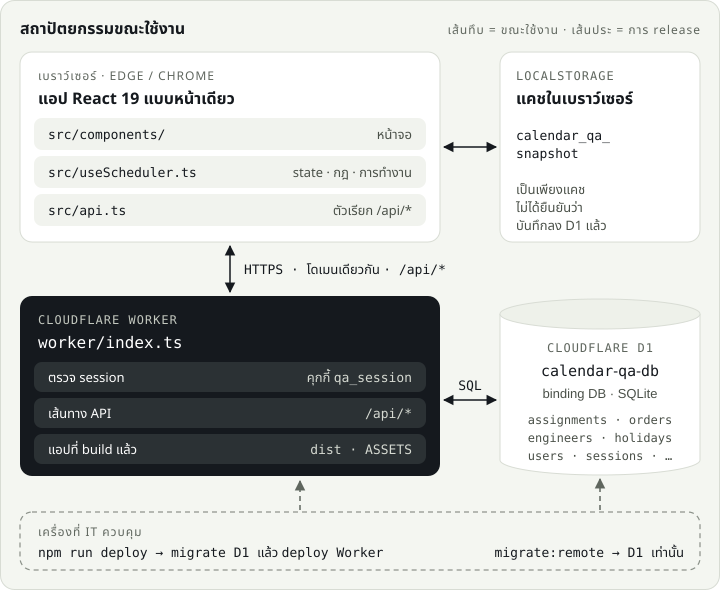

# คู่มือส่งมอบระบบให้ IT

ทุกอย่างที่ทีม IT ของ UTAC ต้องใช้เพื่อรับดูแล UTAC QA Calendar (QMS-CASS): สิ่งที่ต้องตรวจสอบ ใครควรรับผิดชอบอะไร ข้อค้นพบด้านความปลอดภัยที่ยังเปิดอยู่และปัญหาที่ทราบ และวิธี release, migrate, กู้คืน และรับมือเหตุขัดข้อง ส่วนการทำงานของโค้ดดูที่ [คู่มือนักพัฒนา](developer-guide.md)

> [!IMPORTANT]
> ตรวจทานเทียบกับ repository เมื่อวันที่ 27 พฤศจิกายน 2026 ยัง **ไม่ได้** ยืนยันบัญชี Cloudflare, URL, เวอร์ชันที่ deploy และฐานข้อมูลจริงจาก repository ให้ยืนยันสิ่งเหล่านี้ก่อนใช้เอกสารนี้เป็น runbook ของ production

## 1. ภาพรวมระบบ

- **คืออะไร:** เว็บแอปที่ใช้ร่วมกันสำหรับวางแผน Customer Audit (CS) และ Internal Audit (IA) ใน 7 ไซต์ของ UTAC (`UTL1`, `UTL2`, `UTL2A`, `UTL2B`, `UTL3`, `UTL3A`, `UTL3T`) แทนการใช้ spreadsheet ตัวแอปเรียกตัวเองว่า "Calendar Auditor"
- **เทคโนโลยี:** React 19, TypeScript, Vite; Cloudflare Worker หนึ่งตัวที่ส่งไฟล์ static และให้บริการ API `/api/*`; Cloudflare D1 (SQLite)
- **ผู้ใช้:** QA Planner, QMS Host, QA Admin และผู้ทำรายงาน ใช้งานผ่าน Microsoft Edge หรือ Google Chrome
- **ข้อมูลใน D1:** ตารางการตรวจ ชื่อลูกค้า ชื่อ QMS Host ผลตรวจ บันทึก กฎวันหยุด History ที่ใช้ร่วมกัน (`history_log`) บัญชีผู้ใช้ และ session
- **ข้อมูลในแต่ละเบราว์เซอร์ (`localStorage`):** สำเนาตารางการตรวจ (`calendar_qa_snapshot` ซึ่งเก็บรายการตัวเลือก และรายการ History ที่บันทึกขึ้นเซิร์ฟเวอร์ไม่สำเร็จไว้ด้วย) บันทึก (`calendar_qa_comments`) ผู้ใช้ที่จำไว้ (`calendar_qa_session_user`) และบัญชีที่สร้างในเบราว์เซอร์นั้น (`calendar_qa_users`)

## 2. ค่าตั้งค่าที่ต้องตรวจสอบ

ค่าต่อไปนี้มาจาก repository ให้ยืนยันทีละรายการในบัญชี Cloudflare และ GitHub ของบริษัท

| รายการ | ค่าใน repository | หมายเหตุ |
|---|---|---|
| ชื่อ Worker | `utac-qa-calendar` | `wrangler.toml` |
| จุดเริ่มของ Worker | `worker/index.ts` | จัดการ `/api/*` และส่งไฟล์แอปที่ build แล้ว |
| ไฟล์ static | `dist`, binding `ASSETS` | สร้างโดย `npm run build` |
| D1 binding | `DB` → `calendar-qa-db` | Database ID `11c524c4-b02e-4d38-840e-ee98294f2118` |
| Compatibility date | `2025-04-01` | |
| Secret | `REGISTRATION_CODE` | ใช้ควบคุมการสมัคร หากไม่ได้ตั้งค่าไว้ การสมัครทุกครั้งจะถูกปฏิเสธ ตั้งค่าด้วย `npx wrangler secret put REGISTRATION_CODE` ห้ามเก็บค่าไว้ใน Git, ticket หรือเอกสาร |
| อายุ session | 30 วันเมื่อเลือก Remember me; หากไม่เลือก จะอยู่จนกว่าจะปิดเบราว์เซอร์ นานสุด 12 ชั่วโมง | ค่าคงที่ใน `worker/index.ts` |
| การบันทึก log | ไม่มีบล็อก `[observability]` ใน `wrangler.toml` | Workers Logs อาจปิดอยู่ ให้ตรวจใน dashboard |
| Source code | GitHub remote `origin` | ยังไม่ยืนยันเจ้าของ |

**การเปลี่ยน schema ที่รออยู่:** migration `0020_assignment_audit_type.sql` เพิ่มและเติมค่าคอลัมน์ `assignments.audit_type` และ `0021_history_log.sql` สร้างตาราง `history_log` สำหรับ History ที่ใช้ร่วมกัน คำสั่ง `npm run deploy` ครั้งถัดไปจะ apply ทั้งสอง migration (ดู [5.2](#52-migration-ของ-d1)) ทั้งสองเป็นการเพิ่มเท่านั้น Worker ที่ทำงานอยู่จึงยังทำงานได้ตามปกติระหว่างที่ migration รัน ก่อน release ครั้งแรกนั้น ให้ตรวจว่ายังไม่มีคอลัมน์นี้อยู่ (build ทดสอบรุ่นก่อนหน้าเคยเพิ่มคอลัมน์นี้ตอน runtime): `npx wrangler d1 execute calendar-qa-db --remote --command "PRAGMA table_info(assignments)"` หากพบ `audit_type` ในรายการ ให้สอบถามผู้ดูแลโค้ดว่าจะทำเครื่องหมายว่า 0020 apply แล้วอย่างไร แทนการรัน migration นั้น

**สิ่งที่ไม่ได้ประกาศไว้ใน repository:** staging environment, custom domain, Cloudflare account ID, CI/CD workflow และ monitoring alert ซึ่งไม่ได้แปลว่าไม่มีอยู่จริง ให้ตรวจใน dashboard การ push ขึ้น Git อย่างเดียวไม่ได้ deploy อะไร การ deploy ใช้ `npm run deploy`

## 3. เจ้าของระบบและการรับมอบ

### 3.1 ผู้รับผิดชอบที่เสนอ

ระหว่างการส่งมอบอย่างเป็นทางการ ให้แทนแต่ละบทบาทด้วยชื่อบุคคลและช่องทาง escalation

| งาน | ผู้รับผิดชอบที่เสนอ | หน้าที่ |
|---|---|---|
| บัญชี Cloudflare และ Worker | UTAC IT Cloud / Platform Operations | ความเป็นเจ้าของบัญชี, สิทธิ์เท่าที่จำเป็น, การตั้งค่า Worker, การควบคุมการ deploy, domain และ route, การกู้คืนบัญชี |
| D1 และการปกป้องข้อมูล | IT Data / Platform Operations ร่วมกับเจ้าของข้อมูล QA | อนุมัติ migration, นโยบาย backup และ restore, สิทธิ์เข้าถึง, ระยะเก็บข้อมูล, การซ้อมกู้คืน, การตัดสินใจเรื่อง export |
| กระบวนการ QA และคุณภาพข้อมูล | เจ้าของกระบวนการ QA / QMS | นิยามการตรวจ, ฟิลด์บังคับ, สถานะ, รายชื่อ QMS Host, กฎวันหยุด, การยอมรับของผู้ใช้ |
| Source code และ release | ผู้ดูแลแอปของ IT ที่ระบุชื่อ ร่วมกับผู้อนุมัติการเปลี่ยนแปลงฝั่ง QA | สิทธิ์ repository, code review, กระบวนการ release, change log, การคัดแยก defect |
| Identity และความปลอดภัย | UTAC IT Identity / Security | นโยบายการสมัคร, วงจรชีวิตของ admin, ทบทวนการยืนยันตัวตน, รับมือเหตุการณ์, งาน SSO / MFA / สิทธิ์ตามบทบาท หากต้องทำ |

### 3.2 รายการตรวจรับมอบ

1. กำหนดเจ้าของบัญชี Cloudflare และผู้ดูแลที่บริษัทควบคุมอย่างน้อยสองคน เลิกการเป็นเจ้าของโดยบุคคลเพียงคนเดียว และทบทวนสิทธิ์ของผู้ใช้และ token
2. ยืนยัน Worker ของ production, URL หรือ custom domain, ฐานข้อมูล D1, เวอร์ชันที่ deploy, บัญชี Cloudflare และเจ้าของ repository บน GitHub แล้วบันทึกไว้ในทะเบียนบริการของบริษัท ไม่ใช่ในเอกสารสาธารณะ
3. ยืนยันว่าตั้งค่า `REGISTRATION_CODE` แล้วหรือยัง ใครเปลี่ยนรหัสได้ และควรเปิดให้สมัครเองต่อไปหรือไม่
4. สร้าง secret และสิทธิ์ API ที่ IT เป็นเจ้าของ อย่าใช้ credential Cloudflare ส่วนตัวของนักพัฒนา
5. ทบทวน[ข้อค้นพบด้านความปลอดภัย](#4-ข้อค้นพบด้านความปลอดภัย)และ[ปัญหาที่ทราบ](#7-ปัญหาที่ทราบของแอป)ร่วมกับ IT Security และเจ้าของข้อมูล QA และกำหนดผู้รับผิดชอบพร้อมการตัดสินใจของแต่ละข้อ
6. กำหนดผู้อนุมัติ release, ผู้ตัดสินใจ rollback, ผู้ติดต่อฝ่ายสนับสนุน, ระดับชั้นข้อมูล, ระยะเก็บข้อมูล, RPO / RTO และเส้นทาง escalation
7. ตรวจความครอบคลุมของการกู้คืน D1 ตามแผน Cloudflare ปัจจุบัน และซ้อมกู้คืนนอก production
8. ตกลงหลักฐานว่า release สำเร็จ: test, lint และ build ผ่าน, เข้าและออกจากระบบได้, สร้าง / แก้ไข / ลบได้, ดาวน์โหลด Excel ได้, เห็นข้อมูลที่บันทึกใน D1 จากเบราว์เซอร์ที่สอง และ error log ของ Worker ไม่มีข้อผิดพลาด

## 4. ข้อค้นพบด้านความปลอดภัย

ให้ตัดสินใจทุกข้อก่อนเปิดใช้งาน production ในวงกว้าง

| # | ข้อค้นพบ | ความเสี่ยง | การตัดสินใจที่แนะนำ |
|---|---|---|---|
| 1 | `admin` / `user` ไม่ใช่ขอบเขตสิทธิ์ ส่วนหัวแสดงบทบาท แต่ผู้ใช้ที่เข้าสู่ระบบทุกคนเปิด Manage ได้ และ Worker ตรวจเพียงว่ามี session ที่ใช้ได้ | ทุกบัญชีแก้ข้อมูลหลักและกฎวันหยุดได้ | เพิ่มและทดสอบการตรวจบทบาทฝั่งเซิร์ฟเวอร์ หรือยอมรับความเสี่ยงเป็นลายลักษณ์อักษร |
| 2 | การสมัครใช้ `REGISTRATION_CODE` ร่วมกันค่าเดียว บัญชีแรกในฐานข้อมูลว่างจะเป็น `admin` บัญชีต่อมาเป็น `user` ทุกครั้งที่ Worker cold start หากไม่มี admin เลย Worker จะเลื่อนบัญชีที่เก่าที่สุดเป็น admin การลบ admin คนสุดท้ายจึงถูกย้อนกลับ User ID ไม่แยกตัวพิมพ์เล็กใหญ่ และไม่มีหน้าจอสำหรับจัดการ admin หรือปิดบัญชีพนักงานที่ลาออก | ใครที่มีรหัสก็สร้างบัญชีได้ และพนักงานที่ลาออกยังเข้าถึงได้ | ตกลงวงจรชีวิตบัญชีและกระบวนการเปลี่ยนรหัส หรือย้ายไปใช้ SSO ของบริษัท |
| 3 | รหัสผ่าน hash ด้วย SHA-256 แบบมี salt และยาวขั้นต่ำเพียง 4 ตัวอักษร ไม่มี rate limiting หรือการล็อกบัญชีทั้งตอนเข้าสู่ระบบและตอนเปลี่ยนรหัสผ่าน ข้อความ error บอกได้ว่าบัญชีมีอยู่หรือไม่ และการเปรียบเทียบ hash ไม่ได้ทำแบบ constant-time ไม่มี SSO หรือ MFA | การเดารหัสผ่าน รหัสผ่านอ่อน และ hash คำนวณเร็ว | ให้ IT Security อนุมัติ หรือกำหนดให้ใช้ hash ที่แข็งแรงกว่า, rate limiting, นโยบายรหัสผ่าน และ SSO / MFA |
| 4 | เบราว์เซอร์ยังเก็บข้อมูลธุรกิจไว้หลัง sign out: สำเนาตารางการตรวจ รายการตัวเลือก บันทึก รายการ History ที่ยังไม่ได้บันทึก และผู้ใช้ที่จำไว้ (ดูหัวข้อ 1) เมื่อ session ฝั่งเซิร์ฟเวอร์สิ้นสุดแล้ว (เช่น ปิดเบราว์เซอร์โดยไม่ได้เลือก Remember me) แอปยังเปิดขึ้นในสถานะเข้าสู่ระบบและแสดงข้อมูลที่แคชไว้นี้ โดยไม่มี session ที่ใช้ได้ หากบัญชีถูกสร้างในเบราว์เซอร์นั้น การเปลี่ยนรหัสผ่านจะเก็บ hash แบบมี salt ของรหัสผ่านใหม่ไว้ใน `calendar_qa_users` ด้วย | ข้อมูลรั่วไหลบนเครื่องที่ใช้ร่วมกันหรือเครื่องที่สูญหาย ระดับปานกลางบนคอมพิวเตอร์ที่ใช้ร่วมกัน | ใช้นโยบายจัดการอุปกรณ์ และตัดสินใจว่าแอปควรลบหรือลดข้อมูลใน `localStorage` เมื่อ sign out และเมื่อ session สิ้นสุดหรือไม่ |
| 5 | History เก็บใน D1 (`history_log`) และใช้ร่วมกัน โดย Worker บันทึกบัญชีที่เข้าสู่ระบบและเวลาไว้ แต่เบราว์เซอร์เป็นผู้เขียนแต่ละรายการ: คำอธิบายมาจากแอป การเปลี่ยนแปลงจะถูกบันทึกก็ต่อเมื่อเบราว์เซอร์ส่งรายการนั้นมา และผู้ใช้ที่เข้าสู่ระบบคนใดก็เพิ่มรายการผ่าน API ได้ การเปลี่ยนรายชื่อ QMS Host ไม่ถูกบันทึก | History เชื่อถือได้ในเรื่องว่าใครและเมื่อไร แต่ไม่ใช่หลักฐานว่าเปลี่ยนอะไร | ตัดสินใจว่าเท่านี้เพียงพอสำหรับใช้เป็น audit trail อย่างเป็นทางการหรือไม่ หากไม่พอ ให้ Worker บันทึกการเปลี่ยนแปลงเองในทุก route ที่เขียนข้อมูล |
| 6 | Worker เชื่อข้อมูลจากเบราว์เซอร์: ฟิลด์บังคับและกฎวันหยุดตรวจเฉพาะในเบราว์เซอร์ id สร้างโดยเบราว์เซอร์ (หากสองคนสร้างพร้อมกันอาจชนกัน ทำให้บันทึกไม่สำเร็จหรือนัดหมายสองรายการถูกรวมกัน) และการแก้ไขเป็นแบบ last-write-wins | ข้อมูลไม่สอดคล้องกันหรือถูกรวมกัน | เพิ่มการตรวจสอบข้อมูลฝั่งเซิร์ฟเวอร์ และให้เซิร์ฟเวอร์เป็นผู้สร้าง id |
| 7 | response 500 ส่งข้อความ exception ดิบกลับไป และไม่มีการบันทึก log ของ error | เปิดเผยรายละเอียดภายใน และมองไม่เห็นความล้มเหลวใน log | บันทึก error ฝั่งเซิร์ฟเวอร์ และส่งข้อความทั่วไปกลับไป |
| 8 | dependency `xlsx@0.18.5` ไม่ได้ใช้งาน และมี security advisory ที่เผยแพร่แล้ว | เสี่ยงด้าน supply chain โดยไม่ได้ประโยชน์ | ลบออก และรัน `npm audit` เป็นส่วนหนึ่งของการ release |

การควบคุมอื่นที่มีอยู่แล้ว: session เป็น token แบบสุ่มที่เก็บใน D1 เฉพาะค่า hash และส่งใน cookie แบบ HttpOnly, `SameSite=Lax` (`Secure` เมื่อใช้ HTTPS); การเปลี่ยนรหัสผ่านยกเลิกทุก session ของบัญชีนั้น; Worker ปฏิเสธ request ข้าม origin; SQL ทุกคำสั่ง bind พารามิเตอร์

## 5. Runbook การ release และฐานข้อมูล

repository มีการตั้งค่า Wrangler ชุดเดียวและไม่มี staging environment ให้รันคำสั่ง production จาก checkout ที่ IT ควบคุมเท่านั้น หลังยืนยันบัญชีและฐานข้อมูลเป้าหมายแล้ว

### 5.1 การ release โค้ด

1. ทบทวน commit ที่อนุมัติ และยืนยัน branch และเป้าหมาย production
2. ติดตั้ง dependency ตามเวอร์ชันที่ล็อกไว้: `npm ci`
3. รัน `npm test`, `npm run lint` และ `npm run build` แก้ทุกข้อผิดพลาดก่อนทำต่อ
4. ใน Cloudflare dashboard ตรวจเวอร์ชันที่ deploy อยู่และ log ของ Worker ยืนยันว่ามี binding และ secret ครบ โดยไม่พิมพ์ค่า secret ออกมา
5. หาก release นี้มีไฟล์ใหม่ใน `migrations/` ให้ตรวจตาม [5.2](#52-migration-ของ-d1) ให้ครบก่อน
6. Deploy: `npm run deploy` (`scripts/deploy.mjs`) คำสั่งนี้จะ build แสดงรายการ migration ของ D1 ที่ค้างอยู่และขอให้ยืนยัน พิมพ์จุดกู้คืน D1 Time Travel สำหรับ change record แล้ว apply migration จากนั้นจึง deploy Worker หากตอบอย่างอื่นที่ไม่ใช่ `y` หรือ migration ล้มเหลว release จะหยุดก่อนที่โค้ดจะถูก deploy เมื่อรันใน CI หรือใช้ `-- --yes` จะไม่มีการถาม
7. ตรวจหลัง deploy: เข้าสู่ระบบได้, หน้า Schedule ของเดือนปัจจุบันโหลดได้, สร้างและแก้นัดหมายได้, กฎวันหยุดบล็อกได้ตามคาด, Table กรองและ export ได้ โหลดหน้าใหม่ในเบราว์เซอร์ที่สองและยืนยันว่าเห็นการเปลี่ยนแปลง และมีรายการใน **History** ภายใต้ชื่อของคุณ แล้วตรวจ error ของ Worker
8. บันทึก commit, เวลา deploy, ผู้ดำเนินการ, ผลลัพธ์, migration ที่ apply, จุดกู้คืน และเลขอ้างอิงการเปลี่ยนแปลง

### 5.2 Migration ของ D1

migration รันเป็นส่วนหนึ่งของ `npm run deploy` ก่อนโค้ดใหม่ขึ้นใช้งานไม่นาน ระบบ apply เฉพาะ migration ที่ยังไม่เคยรัน ดังนั้น release ที่ไม่มี migration ใหม่จะไม่เปลี่ยนแปลงฐานข้อมูล ก่อน release ที่ **มี** migration ใหม่:

1. อ่าน SQL ใหม่ใน `migrations/` และประเมินผลกระทบหากต้องย้อนกลับ ห้าม release migration ที่ลบข้อมูลโดยไม่ได้ทบทวน
2. ตรวจว่าใช้ได้กับ Worker ที่ทำงานอยู่ตอนนี้ เพราะฐานข้อมูลจะเปลี่ยนก่อนโค้ดใหม่ deploy เพียงครู่เดียว การเพิ่มตารางหรือคอลัมน์ปลอดภัย ยกเว้นกรณีที่ฟังก์ชัน `ensure*()` ของ Worker สร้างคอลัมน์เดียวกันด้วย (migration จะล้มเหลวด้วยข้อความ "duplicate column name") การลบหรือเปลี่ยนชื่อคอลัมน์ที่โค้ดที่ทำงานอยู่ยังใช้ ต้องรอ release ถัดไป
3. ดูว่าจะมีอะไรรัน: `npx wrangler d1 migrations list calendar-qa-db --remote` หากต้องการ ให้ซ้อมบนเครื่องด้วย `npm run deploy -- --local`
4. ขออนุมัติจากเจ้าของข้อมูล QA และทำตามกระบวนการ change ของบริษัท Wrangler ไม่ได้ทำ backup ให้เอง จุดกู้คืนคือ D1 Time Travel และ release จะพิมพ์จุดนี้ออกมา
5. Release ด้วย `npm run deploy` ([5.1](#51-การ-release-โค้ด)) และยืนยันรายการ migration เมื่อถูกถาม
6. หลังจากนั้นรันคำสั่ง list อีกครั้ง ควรไม่มีรายการค้าง

หากต้องการ apply migration โดยไม่ deploy โค้ด (เช่น รันการเติมข้อมูลขนาดใหญ่แยกต่างหาก) ใช้ `npm run migrate:remote` โปรดทราบว่า prompt ของ Wrangler เองถือว่าการตอบ "No" เป็นความสำเร็จ จึงควรใช้คำสั่งนี้เฉพาะเมื่อตั้งใจจะ apply จริง

### 5.3 การย้อนกลับและกู้คืน

- การ rollback โค้ด Worker และการกู้ข้อมูล D1 เป็นคนละขั้นตอน การ rollback โค้ดไม่ได้ย้อน migration หรือนำแถวที่ลบไปแล้วกลับมา ให้ตรวจความเข้ากันของโค้ดกับ schema ก่อน rollback ฝั่งใดฝั่งหนึ่ง
- การ rollback เวอร์ชันของ Worker มีผลทันที ให้ยืนยันเวอร์ชันเป้าหมายและการอนุมัติ แล้วบันทึกไว้
- การกู้ข้อมูล: จำกัดการเขียนข้อมูล หาจุดเวลาที่ถูกต้อง (จุดกู้คืนที่ release พิมพ์ไว้ หรือ `npx wrangler d1 time-travel info calendar-qa-db`) เก็บหลักฐาน และทำตามกระบวนการกู้คืน D1 ที่บริษัทอนุมัติ ทดสอบนอก production เมื่อทำได้ ปัจจุบัน Cloudflare ระบุช่วง D1 Time Travel ไว้ 7 วัน (Workers Free) และ 30 วัน (Workers Paid) ให้ยืนยันแผนที่ใช้ก่อนพึ่งพา
- การกู้คืนที่กระทบข้อมูลจริงต้องได้รับอนุมัติจากเจ้าของข้อมูล QA และมี incident หรือ change record

## 6. การติดตามระบบและเหตุขัดข้อง

1. จาก checkout ที่ได้รับอนุญาต ใช้ `npx wrangler tail` ดู request แบบเรียลไทม์ ตรวจ status code และอ่าน body ของ response 500 ทุกรายการ (มีข้อความ exception อยู่ ซึ่ง Worker ไม่ได้บันทึก log ไว้) หากเปิด Workers Logs ไว้ ให้ตรวจ log ของ Worker `utac-qa-calendar` ใน dashboard ด้วย
2. แยกประเภทความล้มเหลว: ไฟล์ static, Worker API หรือการยืนยันตัวตน, query หรือ migration ของ D1, หรือการเชื่อมต่อของผู้ใช้ รหัส 401 ชี้ไปที่ session, 403 ชี้ไปที่ request ข้าม origin และ 5xx ชี้ไปที่ Worker หรือฐานข้อมูล
3. หากข้อมูลหายหรือไม่อัปเดต ให้ตรวจ error ของ Worker, ข้อมูลที่บันทึกใน D1 จากเบราว์เซอร์ที่สอง และข้อความเตือนการบันทึกในแอป ก่อนขอให้ผู้ใช้แก้ซ้ำ ผู้ใช้ที่ session สิ้นสุดแล้วจะยังเห็นข้อมูลที่แคชไว้ และได้รับคำเตือนการบันทึกทุกครั้งที่แก้ไข ผู้ใช้กลุ่มนี้ควร sign out แล้วเข้าสู่ระบบใหม่
4. บันทึกเวลาและเขตเวลา ผู้ใช้และไซต์ที่ได้รับผลกระทบ request path (ไม่รวม credential) เวอร์ชันที่ deploy และผลกระทบ ห้ามบันทึกรหัสผ่าน cookie registration code หรือ session token
5. แจ้งเหตุสงสัยข้อมูลสูญหายหรือการเข้าถึงโดยไม่ได้รับอนุญาตไปยัง UTAC IT Security และเจ้าของข้อมูล QA ตามกระบวนการรับมือเหตุการณ์ของบริษัท

## 7. ปัญหาที่ทราบของแอป

พฤติกรรมที่ยืนยันแล้วในโค้ดปัจจุบัน ซึ่งผู้ใช้และฝ่ายสนับสนุนควรทราบ แต่ละข้อเป็นรายการที่ควรพิจารณาแก้ไข

| ปัญหา | ผลกระทบ |
|---|---|
| ผลตรวจที่บันทึกเป็น 0 ทุกช่องก่อนการแก้ไขปัญหา | การตรวจเดิมที่ไม่มี finding เลยจะยังเป็นสีอำพันจนกว่าจะมีคนเปิด **Audit Results** แล้วเลือก **Save Results** อีกครั้ง |
| ลำดับ QMS Host ที่ลากจัดไว้ไม่ถูกบันทึก | ลำดับจะรีเซ็ตเมื่อโหลดหน้าใหม่ และผู้ใช้อื่นไม่เห็นลำดับนี้ |
| บันทึกไม่มีผู้เขียนหรือเวลา | ทุกบันทึกแสดง "You" และ "just now" |
| การลากย้ายไม่สนใจกฎของวัน | การลาก การทำสำเนา หรือการคัดลอกสัปดาห์ อาจวางนัดหมายลงในวันที่ถูกบล็อกได้ |
| นัดหมายในวันที่ภายหลังกลายเป็นวันหยุดนักขัตฤกษ์ | เปิดจาก Schedule ไม่ได้ ให้ใช้ Table |
| การเปลี่ยนรายชื่อ QMS Host ไม่อยู่ใน History | การเพิ่ม แก้ไข ลบ หรือจัดลำดับ host ใหม่ ไม่มีบันทึกไว้ |
| อาจเกิด foreign key ล้มเหลวเมื่อสร้างรายการ | เบราว์เซอร์ส่ง order, host และวันของนัดหมายใหม่โดยไม่รอกัน การสร้างจึงอาจล้มเหลวเป็นครั้งคราวด้วยข้อความ "FOREIGN KEY constraint failed" |
| วันหยุดนักขัตฤกษ์ตามปฏิทินจันทรคติกำหนดไว้เฉพาะปี 2026–2028 | ปีถัดไปต้องอัปเดตใน `src/holidays.ts` |

## 8. การยอมรับการส่งมอบ

ทำร่วมกัน โดยระบุผู้รับผิดชอบและหลักฐานของแต่ละข้อ

- [ ] ยืนยันว่าบริษัทเป็นเจ้าของ source repository และบัญชี Cloudflare แล้ว
- [ ] บันทึก Worker, URL หรือ domain, ฐานข้อมูล D1, secret และเวอร์ชันที่ deploy ไว้ในที่เก็บภายในที่อนุมัติแล้ว
- [ ] ตรวจสถานะ migration ของ production แล้ว และซ้อมกู้คืนฐานข้อมูลนอก production แล้ว
- [ ] IT Security และ QA ทบทวนข้อค้นพบเรื่องการสมัคร วงจรชีวิตของ admin และการบังคับสิทธิ์ตามบทบาทแล้ว
- [ ] จัดการข้อค้นพบเรื่องแคชในเบราว์เซอร์ audit trail และการเก็บข้อมูลแล้ว หรือเจ้าของข้อมูลยอมรับอย่างเป็นทางการแล้ว
- [ ] คัดแยกปัญหาที่ทราบของแอปแล้ว โดยแต่ละข้อมีผู้รับผิดชอบหรือเป็นความเสี่ยงที่ยอมรับแล้ว
- [ ] กำหนดผู้รับผิดชอบด้าน release, rollback, การติดตามระบบ, การสนับสนุน, RPO / RTO และ escalation แล้ว
- [ ] ผู้ใช้ QA ตรวจรับขั้นตอนการทำงานและการ export ที่ตกลงกันแล้ว

## เอกสารอ้างอิง

เอกสาร Cloudflare (ตรวจการเปลี่ยนแปลงก่อนทุกครั้ง): [Workers deploy and rollback](https://developers.cloudflare.com/workers/wrangler/commands/workers/) · [D1 migrations](https://developers.cloudflare.com/d1/wrangler-commands/) · [D1 Time Travel and backups](https://developers.cloudflare.com/d1/reference/time-travel/) · [Worker secrets](https://developers.cloudflare.com/workers/configuration/secrets/) · [Worker logs](https://developers.cloudflare.com/workers/observability/logs/) · [Workers roles and permissions](https://developers.cloudflare.com/workers/authorization/workers/)
