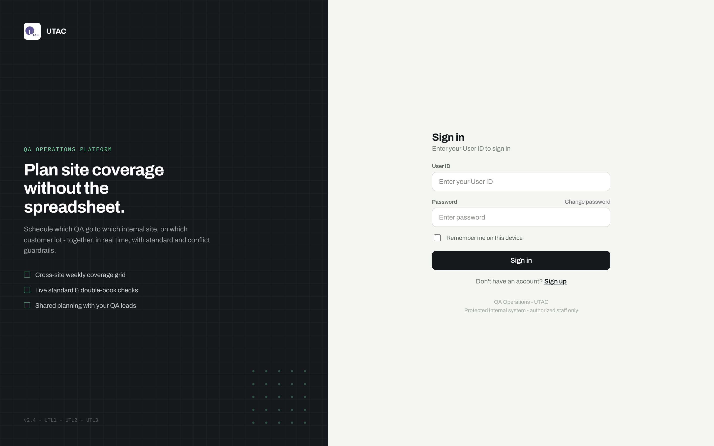
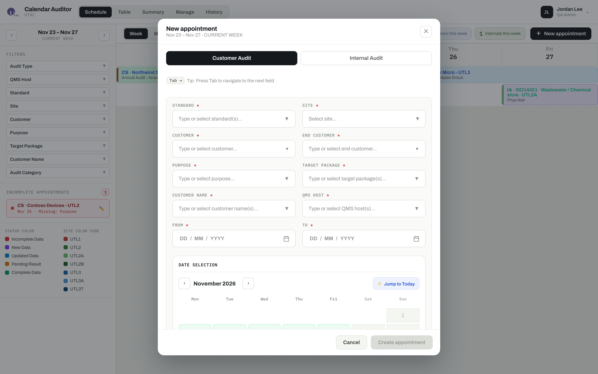
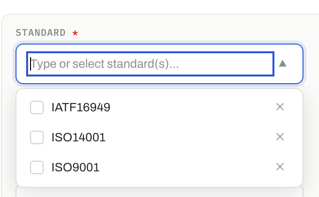

# คู่มือผู้ใช้

วิธีวางแผน Customer Audit (CS) และ Internal Audit (IA) ใน UTAC QA Calendar (QMS-CASS) ซึ่งในแอปแสดงชื่อว่า **Calendar Auditor** รวมถึงการบันทึกผลตรวจ การดูแลข้อมูลที่อยู่เบื้องหลัง และการจัดทำรายงาน ส่วนแรกอธิบายว่าปฏิทินทำงานอย่างไร ส่วนที่สองเป็นขั้นตอนการทำงานแยกตามบทบาท

> [!NOTE]
> บทบาทในคู่มือนี้บอกว่าใครมักทำงานใด ระบบไม่ได้ซ่อนเมนูตามบทบาท ดังนั้นก่อนแก้ข้อมูลที่ใช้ร่วมกัน ให้ทำตามขั้นตอนอนุมัติของหน่วยงาน

## 1. ก่อนเริ่มใช้งาน

### 1.1 เบราว์เซอร์

ใช้ **Microsoft Edge** (เบราว์เซอร์มาตรฐานของ UTAC) หรือ **Google Chrome** เวอร์ชันปัจจุบันในหน้าต่างปกติ

- หลีกเลี่ยงหน้าต่าง InPrivate หรือ Incognito เพราะจะต้องเข้าสู่ระบบใหม่ทุกครั้ง
- อย่าตั้งค่าให้เบราว์เซอร์ล้าง cookies และข้อมูลเว็บไซต์เมื่อปิด มิฉะนั้นจะต้องเข้าสู่ระบบใหม่ทุกครั้ง
- อนุญาตการดาวน์โหลดจากแอป เพื่อให้บันทึกไฟล์ส่งออก Excel (`.xlsx`) และ CSV ได้

### 1.2 เข้าสู่ระบบ

1. กรอก **User ID** และ **Password** แล้วเลือก **Sign in** ระบบจะเปิดหน้า **Schedule** ของเดือนปัจจุบัน
2. ติ๊ก **Remember me on this device** เพื่อคงการเข้าสู่ระบบไว้ได้นานสูงสุด 30 วัน หากไม่ติ๊ก เซสชันจะสิ้นสุดเมื่อปิดเบราว์เซอร์ และอยู่ได้นานสุด 12 ชั่วโมง
3. บัญชีใหม่: เลือก **Sign up** แล้วกรอก **User ID** (อย่างน้อย 3 ตัว ใช้ตัวอักษร ตัวเลข `.`, `_` หรือ `-`), **Staff registration code** (รับจากผู้ดูแลระบบ), **Password** (อย่างน้อย 4 ตัว) และ **Confirm password** จากนั้นระบบจะกลับไปที่หน้า **Sign in** ให้เข้าสู่ระบบด้วยบัญชีใหม่
4. เปลี่ยนรหัสผ่าน: เลือก **Change password** และกรอกรหัสผ่านปัจจุบันก่อน เมื่อเปลี่ยนแล้วทุกเซสชันของบัญชีจะสิ้นสุด ให้เข้าสู่ระบบใหม่ด้วยรหัสใหม่ ระบบไม่มีการรีเซ็ตแบบ "forgot password" หากลืมรหัสผ่าน ให้ติดต่อผู้ดูแลระบบ

### 1.3 เมนูหลัก

แถบด้านบนมี 5 หน้า: **Schedule** (ปฏิทิน), **Table** (รายการที่ค้นหาได้), **Summary** (สรุปรายปี), **Manage** (QMS Host ตัวเลือก และวันหยุด) และ **History** (ประวัติการเปลี่ยนแปลง) เปิดเมนูใต้ชื่อของคุณเพื่อไปที่ **Your profile** และ **Sign out** บนโทรศัพท์ (หรือหน้าต่างที่แคบกว่า 860px) ทั้ง 5 หน้าจะอยู่ที่แถบด้านล่างของหน้าจอ และ **Table** กับ **History** จะแสดงแต่ละรายการเป็นการ์ด ส่วนตัวกรองใน **Table** เปิดได้ด้วยปุ่ม **Filters** บนโทรศัพท์ แถบใต้ **Week / Month / Year** จะแสดงสัปดาห์ เดือน หรือปีที่กำลังดู พร้อมปุ่ม **Today** และลูกศรสำหรับเลื่อน ในมุมมอง **Week** แตะวันในแถบวันทำการ ในมุมมอง **Month** แต่ละวันจะแสดงจุดหนึ่งจุดต่อหนึ่งนัดหมายตามสีสถานะ แตะวันเพื่อดูรายการนัดหมายของวันนั้นใต้ปฏิทิน

")

> [!WARNING]
> หากใช้เครื่องร่วมกัน ให้เลือก **Sign out** เมื่อใช้งานเสร็จ การ Sign out จะสิ้นสุดเซสชัน แต่เบราว์เซอร์ยังเก็บสำเนาข้อมูลปฏิทิน (นัดหมาย ชื่อลูกค้า และโน้ต) ไว้ อย่าใช้เครื่องที่ใช้ร่วมกันหรือเครื่องสาธารณะกับข้อมูลการตรวจที่เป็นความลับ

## 2. ปฏิทินทำงานอย่างไร

### 2.1 ไซต์

ปฏิทินครอบคลุม 7 ไซต์ แต่ละไซต์มีสีประจำที่ใช้กับแถบด้านซ้ายของการ์ด สีปัจจุบันดูได้ที่ **Site Color Code** ในแถบด้านข้างของหน้า Schedule ผู้ดูแลระบบเปลี่ยนสี รวมถึงเพิ่มหรือลบไซต์ได้ที่ **Manage → Options → Site** (ช่องสีข้างแต่ละไซต์) กฎ `Shutdown Plant` ล็อกได้เฉพาะ 7 ไซต์ด้านล่างนี้เท่านั้น

| ไซต์ | สีเริ่มต้น |
|---|---|
| `UTL1` | `#c0392b` |
| `UTL2` | `#2e7d32` |
| `UTL2A` | `#66bb6a` |
| `UTL2B` | `#1b5e20` |
| `UTL3` | `#1e5fa8` |
| `UTL3A` | `#4a90d9` |
| `UTL3T` | `#123f73` |

### 2.2 สถานะของนัดหมาย

สีพื้นของการ์ดบอกสถานะ ระบบคำนวณสถานะให้เอง ผู้ใช้ไม่ต้องตั้งค่าเอง

| สี | สถานะ | ความหมาย | สิ่งที่ต้องทำ |
|---|---|---|---|
| 🔴 แดง | Incomplete Data | ฟิลด์ที่จำเป็นหรือช่วงวันที่ยังไม่ครบ | ดูได้ที่ **Incomplete Appointments** ในแถบด้านข้างของหน้า Schedule แต่ละรายการแสดง "Missing: …" คลิกรายการเพื่อเปิดแบบฟอร์ม |
| 🔵 น้ำเงิน | Updated Data | ข้อมูลครบ และมีการแก้ไขภายใน 7 วันที่ผ่านมา (การบันทึกผลตรวจนับเป็นการแก้ไข) | ตรวจว่าการแก้ไขถูกต้อง |
| 🟣 ม่วง | New Data | ข้อมูลครบ และสร้างภายใน 7 วันที่ผ่านมา | ไม่ต้องทำอะไร เป็นนัดหมายใหม่ |
| 🟡 อำพัน | Pending Result | ถึงวันแรกของการตรวจแล้ว ยังไม่มีการบันทึกผลที่มากกว่า 0 และไม่ได้สร้างหรือแก้ไขภายใน 7 วันที่ผ่านมา | บันทึกผลตรวจ |
| 🟢 เขียว | Complete Data | ข้อมูลครบและไม่มีงานค้าง | ไม่ต้องทำอะไร |

ระบบตรวจตามลำดับในตาราง: แดงก่อน แล้วน้ำเงิน ม่วง อำพัน และสุดท้ายเขียว ดังนั้นนัดหมายที่สร้างในสัปดาห์นี้แล้วถูกแก้ไข จะแสดงเป็นน้ำเงิน ไม่ใช่ม่วง และการตรวจที่เลยวันตรวจไปแล้วจะแสดงเป็นม่วงหรือน้ำเงิน ไม่ใช่อำพัน ตราบใดที่ยังมีอายุไม่ถึง 7 วัน

")

### 2.3 กฎของวัน

ช่องวันบอกว่าวันนั้นรับการตรวจได้หรือไม่ ให้อ่านป้ายบนช่องวันทุกครั้ง

| ช่องวัน | กฎ | Customer Audit (CS) | Internal Audit (IA) |
|---|---|---|---|
| ขาว | วันทำงานปกติ | อนุญาต | อนุญาต |
| เทา | `Public Holiday` | ไม่ถูกจอง และถูกข้ามเมื่ออยู่ในช่วงวันที่ | ไม่ถูกจอง และถูกข้ามเมื่ออยู่ในช่วงวันที่ |
| น้ำเงิน | `No Customer Audits` | ห้าม: ช่วงวันที่ของ CS ที่มีวันนี้อยู่ด้วยจะบันทึกไม่ได้ | อนุญาต |
| น้ำเงิน | `Shutdown Plant` | ห้าม: ช่วงวันที่ของ CS ที่มีวันนี้อยู่ด้วยจะบันทึกไม่ได้ | อนุญาตเฉพาะไซต์ที่กฎไม่ได้ล็อก |

- วันเสาร์-อาทิตย์และวันหยุดนักขัตฤกษ์ที่อยู่ในช่วงวันที่จะถูกข้าม และระบบจะจองวันที่เหลือ หากทุกวันในช่วงถูกข้ามทั้งหมด ระบบจะไม่ยอมบันทึก ช่องวันเสาร์-อาทิตย์และวันหยุดคลิกไม่ได้
- เมื่อช่วงวันที่มีวัน `No Customer Audits` หรือ `Shutdown Plant` แบบฟอร์มจะเปลี่ยนเป็น **Internal Audit** และไซต์ที่ถูกล็อกโดย `Shutdown Plant` จะถูกนำออกจาก **Site**
- การเลือก **Reset to Normal Day** ที่วันหยุดนักขัตฤกษ์ซึ่งระบบตั้งไว้ให้ จะเปลี่ยนวันนั้นเป็นวันทำงาน (`Working Day`)
- กฎวันหยุดไม่ย้ายหรือลบนัดหมายที่มีอยู่แล้ว นัดหมายในวันที่ภายหลังกลายเป็นวันหยุดนักขัตฤกษ์จะเปิดจากหน้า Schedule ไม่ได้ ให้แก้ไขหรือลบจากหน้า **Table**

### 2.4 ฟิลด์ที่จำเป็น

| ประเภท | ฟิลด์ที่จำเป็น |
|---|---|
| Customer Audit (CS) | Standard, Site, Customer, End Customer, Purpose, Target Package, Customer Name, QMS Host และช่วงวันที่ที่ถูกต้อง |
| Internal Audit (IA) | Standard, Site, Audit Category, Area, QMS Host และช่วงวันที่ที่ถูกต้อง |

บันทึกนัดหมายได้แม้ยังกรอกไม่ครบทุกฟิลด์ แต่ปุ่ม **Create appointment** จะกดไม่ได้จนกว่าจะมีค่าในฟิลด์หลักอย่างน้อยหนึ่งฟิลด์: สำหรับ CS คือฟิลด์ใดฟิลด์หนึ่งใน Customer, Standard, Site, Customer Name, Purpose หรือ QMS Host สำหรับ IA คือฟิลด์ใดฟิลด์หนึ่งใน Audit Category, Area, Standard, Site หรือ QMS Host หากเว้นวันที่ **From** ไว้ ระบบจะใช้วันนี้ นัดหมายที่ยังไม่ครบจะเป็นสีแดง และแสดงในรายการ **Incomplete Appointments** จนกว่าจะกรอกครบ

## 3. QA Planner: วางแผนการตรวจ

### 3.1 สร้าง Customer Audit (CS)

1. เปิด **Schedule** เลือก **Month** แล้วใช้ลูกศรไปยังเดือนที่ต้องวางแผน
2. ตรวจช่องวัน หากมีวัน `No Customer Audits` หรือ `Shutdown Plant` อยู่ในช่วงวันที่ จะจอง CS ไม่ได้ ส่วนวันเสาร์-อาทิตย์และวันหยุดนักขัตฤกษ์จะถูกข้าม
3. เลือก **New appointment** หรือคลิกวันที่เพื่อเปิดรายการของวันนั้น แล้วเลือก **+ New Appointment** ระบบเลือก **Customer Audit** ไว้ให้แล้ว ยกเว้นวันนั้นเป็นวัน `No Customer Audits` หรือ `Shutdown Plant`
4. กรอก 8 ฟิลด์ของ CS และกำหนด **From** และ **To** วันสิ้นสุดต้องไม่อยู่ก่อนวันเริ่ม
5. เลือก **Create appointment**
6. ตรวจว่าการ์ดอยู่ในวันและไซต์ที่ถูกต้อง หากเป็นสีแดง ให้กรอกให้ครบจาก **Incomplete Appointments**

**Customer** และ **End Customer** รับได้ค่าเดียว: พิมพ์เพื่อค้นหา หรือพิมพ์ชื่อใหม่ ส่วน **Standard**, **Site**, **Purpose**, **Target Package**, **Customer Name** และ **QMS Host** (รวมถึง **Area** สำหรับ IA) รับได้หลายค่า: พิมพ์เพื่อกรอง ติ๊กค่าที่ต้องการ หรือเพิ่มค่าใหม่ด้วย **＋ Add "…"** ปุ่ม **×** บนแท็กที่เลือกไว้จะนำค่านั้นออกจากนัดหมายนี้เท่านั้น ส่วนปุ่ม **✕** ข้างค่าในรายการที่เปิดอยู่จะลบค่านั้นออกจากรายการตัวเลือกที่ใช้ร่วมกัน ซึ่งมีผลกับทุกคน

### 3.2 สร้าง Internal Audit (IA)

1. เลือกวันปกติ วัน `No Customer Audits` หรือวัน `Shutdown Plant` ที่กฎไม่ได้ล็อกไซต์ของคุณ
2. เลือก **New appointment** หรือคลิกวันที่แล้วเลือก **+ New Appointment** จากนั้นเลือก **Internal Audit**
3. กรอก 5 ฟิลด์ของ IA และช่วงวันที่ ในช่อง **Area** เลือกได้หลายค่าหรือเพิ่มค่าใหม่ หลายค่าจะแสดงคั่นด้วย ` / `
4. เลือก **Create appointment** แล้วตรวจการ์ด

### 3.3 ค้นหา แก้ไข หรือลบนัดหมาย

1. กรองปฏิทินด้วยตัวกรองที่แถบด้านข้าง: **Audit Type**, **QMS Host**, **Standard**, **Site**, **Customer**, **Purpose**, **Target Package**, **Customer Name**, **Audit Category** กด **Clear all** เพื่อล้างตัวกรอง ตัวกรองเปลี่ยนเฉพาะสิ่งที่คุณเห็นเท่านั้น
2. คลิกวันเพื่อเปิดรายการของวันนั้น การ์ดแต่ละใบมี **Audit Results** (ไอคอนคลิปบอร์ด) ไอคอนรูปตาเพื่อดูรายละเอียด ✏️ เพื่อแก้ไข และ ✕ เพื่อลบ
3. สำหรับนัดหมายหลายวัน หน้า Schedule จะถามว่า **Edit this day only** หรือ **Edit entire appointment** และ **Delete this day only** หรือ **Delete entire appointment** เมื่อแก้ไขเพียงวันเดียว ช่อง **From** และ **To** จะถูกล็อก
4. เลือก **Save changes** แล้วตรวจวัน ไซต์ และสถานะอีกครั้ง

> [!NOTE]
> ในหน้า **Table** แต่ละแถวคือหนึ่งวัน การกด ✕ ที่วันหนึ่งของนัดหมายหลายวันจะมีตัวเลือก **This day** (ลบเฉพาะวันนั้น) หรือ **All N days** (ลบนัดหมายทั้งชุด) ส่วนนัดหมายวันเดียวจะแสดง **Delete**

")

## 4. QMS Host: ตรวจตารางและบันทึกผล

### 4.1 ตรวจการตรวจที่ได้รับมอบหมาย

1. เปิด **Schedule** แล้วกรองด้วยชื่อของคุณใน **QMS Host** และด้วย **Site** ของคุณ
2. ตรวจวันที่ ไซต์ ประเภทการตรวจ Standard และ Customer (CS) หรือ Area (IA)
3. หากข้อมูลไม่ถูกต้อง ให้แจ้ง QA Planner แทนการแก้เองโดยไม่ได้รับอนุมัติ
4. ก่อนตรวจ IA ในวัน `Shutdown Plant` ให้ยืนยันว่าไซต์ของคุณไม่ถูกล็อก

### 4.2 บันทึกผลตรวจ

1. เปิดนัดหมายแล้วเลือกไอคอน **Audit Results**
2. กรอก **Major**, **Minor**, **OFI**, **OBS** และ **Finding(s)** ของแต่ละไซต์ แถวจะครอบคลุมทุกไซต์ในชุดนัดหมาย (มีแถว **General** แถวเดียวหากไม่มีไซต์)
3. ตรวจตัวเลขและไซต์ แล้วเลือก **Save Results** ผลตรวจใช้กับทั้งชุดของนัดหมายหลายวัน
4. สำหรับข้อมูลส่งต่องาน ให้ขยายการ์ดแล้วใช้ส่วน **NOTES** โน้ตเป็นของวันนั้นเท่านั้น และไม่ได้บันทึกว่าใครเขียนหรือเขียนเมื่อใด (ทุกโน้ตแสดง "You" และ "just now") จึงควรใส่ชื่อและวันที่ไว้ในข้อความ
5. หลัง **Save Results** การ์ดจะเป็นสีน้ำเงินเป็นเวลา 7 วัน แล้วจึงเปลี่ยนเป็นสีเขียว

> [!IMPORTANT]
> **Save Results** จะบันทึกผลแม้ทุกจำนวนเป็น 0 ดังนั้นการตรวจที่ไม่มี finding เลยจะเปลี่ยนเป็นสีเขียวได้ **Clear Results** จะลบผลตรวจออก และการ์ดจะกลับเป็นสีอำพัน ผลตรวจที่ทุกจำนวนเป็น 0 ซึ่งบันทึกด้วยแอปเวอร์ชันเก่ายังคงถือว่า "ไม่มีผล": ให้เปิด **Audit Results** แล้วเลือก **Save Results** อีกครั้ง

> [!TIP]
> หากผลตรวจหายไปหลังรีเฟรช ให้อ่านข้อความแจ้งเตือน และแจ้ง QA Planner หรือผู้ดูแลระบบก่อนบันทึกซ้ำ การบันทึกซ้ำอาจทำให้ข้อมูลซ้ำซ้อน

## 5. QA Admin: ดูแล QMS Host ตัวเลือก และวันหยุด

### 5.1 QMS Host

1. เปิด **Manage → QMS Host**
2. กรองด้วย **Site**, **Standard** หรือ **Department** เพื่อหาคนที่ต้องการ
3. เลือก **New QMS Host** เพื่อเพิ่มคน หรือคลิกแถวเพื่อแก้ **Name**, **Site**, **Standard** (Internal Audit / Customer Audit) และ **Department** (QA / Non-QA) บันทึกด้วย **Create QMS Host** หรือ **Save Changes** การเปลี่ยนชื่อ host จะเปลี่ยนชื่อในนัดหมายที่มีอยู่ของคนนั้นด้วย
4. หากต้องการลบ host ให้ย้ายนัดหมายของคนนั้นไปให้คนอื่นก่อน ระบบจะไม่ยอมลบ host ที่ยังอยู่ในนัดหมายใด ๆ ไม่ว่าจะเป็นนัดหมายในอดีตหรืออนาคต

คุณลากแถวได้ แต่ลำดับใหม่จะไม่ถูกบันทึก: ลำดับจะกลับเป็นแบบเดิมเมื่อโหลดหน้าใหม่ และคนอื่นจะไม่เห็นลำดับนั้น

")

### 5.2 ตัวเลือกในแบบฟอร์ม

1. เปิด **Manage → Options** ระบบแสดงทุกกลุ่ม: **Site** (พร้อมช่องสี), **Standard** (Internal Audit และ Customer Audit), **Customer**, **End Customer**, **Purpose**, **Target Package**, **Customer Name** และ **Audit Category**
2. เพิ่มค่าด้วยช่องข้อความและ **+ Add** (หรือกด Enter) ลากค่าเพื่อเรียงลำดับใหม่ และลบค่าด้วย **✕** ตรวจตัวสะกดและค่าซ้ำก่อน
3. ระบบจะไม่ยอมลบค่าที่ยังมีนัดหมายใช้อยู่ (ทุกกลุ่มยกเว้น Audit Category) การลบนัดหมายสุดท้ายที่ใช้ค่า Customer, End Customer, Purpose หรือ Audit Category จะลบค่านั้นออกจาก Options ด้วย

### 5.3 วันหยุดและข้อจำกัด

1. เปิด **Manage → Holidays** เปลี่ยนปีด้วยลูกศร หรือพิมพ์ปี 4 หลักแล้วกด Enter
2. คลิกวันที่ หรือเลือก **Add Date Range Rule** ในหน้าต่าง **Configure Calendar Status** ให้เลือก **Public / General Holiday**, **Shutdown Plant** หรือ **No Customer Audits** กฎใหม่จะเริ่มต้นเป็น No Customer Audits จึงต้องตรวจตัวเลือกให้ดี
3. สำหรับ `Shutdown Plant` ให้ติ๊กไซต์ที่ต้องล็อกใน **Affected Sites (Shutdown)** ค่าเริ่มต้นไม่มีไซต์ถูกติ๊ก ใช้ **Select All** หากกระทบทุกไซต์ ปุ่ม **Save Status** จะกดไม่ได้จนกว่าจะติ๊กอย่างน้อยหนึ่งไซต์
4. กรอก **Holiday name / note** (ไม่บังคับ) ตรวจวันที่ กฎ และไซต์ แล้วเลือก **Save Status**
5. เลือกการ์ด **Public Holidays** เพื่อดูวันหยุดของปีเรียงตามวันที่ ใช้ **Reset to Normal Day** เพื่อล้างกฎของวันนั้น

")

> [!NOTE]
> ยังไม่มีการนำเข้าวันหยุดจากไฟล์ Excel หรือ CSV ให้เพิ่มกฎบนปฏิทินหรือด้วย **Add Date Range Rule**

## 6. รายงาน: ค้นหา ส่งออก และดูประวัติ

### 6.1 Table และการส่งออก

1. เปิด **Table** ค้นหาด้วยข้อความ หรือใช้ตัวกรอง **All Audits / Customer Audit / Internal Audit**, **All Sites**, **All Standards**, **All Audit Categories**, **All Target Packages**, **All Customers**, **All QMS Hosts** และวันที่ **From / To**
2. คลิกหัวคอลัมน์เพื่อเรียง คลิกซ้ำเพื่อกลับลำดับ **Reset filters** ล้างเงื่อนไขทั้งหมด
3. ตรวจจำนวนที่ส่วนหัว ("N audits · M scheduled days") แล้วเลือก **Export Excel** หรือ **Export CSV** ไฟล์จะมีทุกแถวที่ผ่านตัวกรอง เรียงตามลำดับปัจจุบัน ครบทุกหน้า โดยหนึ่งแถวคือหนึ่งวันที่จัดตารางไว้: Date, Audit Type, Customer, Site, Standard, Audit Category, Purpose (Area สำหรับ IA), Target Package, Customer Name และ QMS Host ไม่รวม End Customer ผลตรวจ และโน้ต
4. เปิดไฟล์ ตรวจหัวคอลัมน์ จำนวนแถว และไซต์ตัวอย่างก่อนส่งต่อ

")

### 6.2 Summary

เปิด **Summary** เพื่อดูยอดรวมของปี: จำนวนการตรวจ การเข้าตรวจของลูกค้าแยกตามไซต์และเดือน และผลตรวจแยกตามไซต์ เลือกปีด้วยลูกศรหรือช่องปี

- **Audit Visits by Site → Export to Excel** ดาวน์โหลดไฟล์ `audit-visits-YEAR.xlsx` (นับเฉพาะวันตรวจรายไซต์ของ Customer Audit)
- **Audit Findings by Site → Export to Excel** มีตัวเลือก **Export All Sites (Full Matrix)**, **Export Summary Only** หรือเลือกไซต์เดียว

")

### 6.3 History

เปิด **History** เพื่อดูว่าทุกคนเปลี่ยนแปลงอะไรบ้าง ได้แก่ นัดหมาย ผลตรวจ ตัวเลือก และกฎวันหยุด เซิร์ฟเวอร์บันทึกว่าใครเป็นผู้เปลี่ยนแปลงแต่ละรายการและเปลี่ยนเมื่อใด ชื่อที่แสดงจึงเป็นบัญชีที่เข้าสู่ระบบอยู่ในขณะนั้น กรองด้วยข้อความ **Action**, **Entity** และช่วงวันที่ เวลาแสดงตามเวลาท้องถิ่นของคุณ History จะโหลดการเปลี่ยนแปลงล่าสุด 200 รายการก่อน เลือก **Load older changes** ที่ด้านล่างเพื่อดูรายการก่อนหน้า (ตัวกรองค้นหาเฉพาะการเปลี่ยนแปลงที่โหลดมาแล้ว) ระบบไม่บันทึกการเปลี่ยนแปลงรายชื่อ QMS Host ในหน้า Manage หากพบสิ่งผิดปกติ ให้จดเวลาและรายการ แล้วติดต่อ QA Admin

> [!NOTE]
> รายการที่มีป้าย **This browser only** เก็บไว้เฉพาะในเครื่องนี้: เป็นรายการที่บันทึกไว้ก่อนที่ History จะย้ายไปเก็บบนเซิร์ฟเวอร์ หรือบันทึกไปที่เซิร์ฟเวอร์ไม่สำเร็จ (จะมีข้อความแจ้งเตือนเมื่อเกิดกรณีนี้) เพื่อนร่วมงานจะไม่เห็น และจะหายเมื่อล้างข้อมูลเบราว์เซอร์

")

> [!WARNING]
> ไฟล์ที่ส่งออกอาจมีชื่อลูกค้าและรายละเอียดการตรวจ ให้จัดเก็บและส่งต่อตามแนวทางการจัดการข้อมูลของ UTAC

## 7. ตรวจสอบก่อนจบวัน

- **QA Planner:** ไม่มีการ์ดสีแดงค้าง นัดหมายใหม่และที่แก้ไขมีวันที่และผู้รับผิดชอบถูกต้อง
- **QMS Host:** บันทึกผลของการตรวจที่เสร็จแล้ว รายการที่ค้างมีผู้รับผิดชอบและวันติดตาม
- **QA Admin:** ตรวจคำขอแก้ข้อมูลหลักและกฎวันหยุดกับไซต์และวันที่ที่ถูกต้อง
- **ผู้ทำรายงาน:** ยืนยันตัวกรองและช่วงเวลาก่อนส่งไฟล์
- **ทุกคน:** Sign out เมื่อใช้เครื่องร่วมกัน

## 8. แก้ปัญหาเบื้องต้น

| ปัญหา | สิ่งที่ต้องตรวจ |
|---|---|
| ไม่พบนัดหมาย | เดือนหรือปี มุมมอง (Week / Month / Year) และตัวกรองที่ใช้อยู่ ลองกด **Clear all** มุมมองเดือนแสดงการ์ดได้สูงสุด 3 ใบต่อวัน พร้อม "+N more" |
| การ์ดเป็นสีแดง | **Incomplete Appointments** ในแถบด้านข้างของหน้า Schedule แสดง "Missing: …" ของการ์ดนั้น |
| จอง CS ไม่ได้ | มีวัน `No Customer Audits` หรือ `Shutdown Plant` อยู่ในช่วงวันที่ หรือทุกวันในช่วงเป็นวันเสาร์-อาทิตย์หรือวันหยุดนักขัตฤกษ์ |
| จอง IA ไม่ได้ | ทุกวันในช่วงเป็นวันเสาร์-อาทิตย์หรือวันหยุดนักขัตฤกษ์ หรือมีวัน `Shutdown Plant` ในช่วงวันที่ที่ล็อกไซต์ของคุณไซต์ใดไซต์หนึ่ง |
| เปิดนัดหมายจากหน้า Schedule ไม่ได้ | วันนั้นกลายเป็นวันหยุดนักขัตฤกษ์ ให้เปิดจากหน้า **Table** |
| ข้อมูลดูไม่เป็นปัจจุบัน หรือทุกการเปลี่ยนแปลงแสดง "A change could not be saved to the shared calendar" | เซสชันของคุณสิ้นสุดแล้ว (ปิดเบราว์เซอร์โดยไม่ได้ติ๊ก Remember me, ครบกำหนด 12 ชั่วโมงหรือ 30 วัน หรือมีการเปลี่ยนรหัสผ่าน) แต่แอปยังแสดงสำเนาข้อมูลในเบราว์เซอร์นี้อยู่ ให้เลือก **Sign out** แล้วเข้าสู่ระบบใหม่ |
| การเปลี่ยนแปลงหายไปหลังรีเฟรช | อ่านข้อความแจ้งเตือนและตรวจการเชื่อมต่อ แจ้งปัญหาก่อนลองทำซ้ำ |
| ไฟล์ส่งออกไม่ตรง | ตัวกรอง ช่วงวันที่ ปี และจำนวนผลลัพธ์ |
| หน้าเข้าสู่ระบบขึ้นมาทุกครั้ง | ใช้ InPrivate/Incognito หรือเบราว์เซอร์ล้างข้อมูลเว็บไซต์เมื่อปิด |
| เข้าสู่ระบบหรือสมัครไม่ได้ | ตรวจ User ID และรหัสผ่าน ขอรหัสลงทะเบียนจากผู้ดูแลระบบ หรือขอให้รีเซ็ตรหัสผ่านที่ลืม |

เมื่อแจ้งปัญหา ให้ระบุหน้า เวลา ไซต์ และขั้นตอนที่ทำ และลบข้อมูลลูกค้าออกจากภาพหน้าจอ
